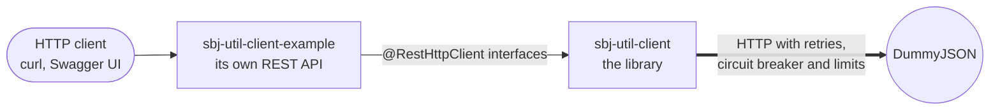

# sbj-util-client-annotation

[Español](README.md) | **English**

**Declarative** REST clients for Spring Boot 4, with built-in resilience, and an example application that uses
them. You declare an interface with the Spring Web annotations you already know and the library generates the
client:

```java
@RestHttpClient(url = "${users.url}", retry = @RetryConfig(maxRetries = 3))
public interface UsersClient {

    @GetMapping("/users/{id}")
    User find(@PathVariable("id") long id);

    @PostMapping("/users")
    User create(@RequestBody User user);
}
```

This repository contains two independent Maven projects:

| Project | What it is | Documentation |
|---|---|---|
| [`sbj-util-client`](sbj-util-client) | The **library** (`io.github.programming0026.juniverse.client:juniverse-client-annotation`, version 2.0.0). | [README](sbj-util-client/README.en.md) |
| [`sbj-util-client-example`](sbj-util-client-example) | An **example application** that consumes [DummyJSON](https://dummyjson.com) (products, authentication and images) with hexagonal architecture and SOLID principles. | [README](sbj-util-client-example/README.en.md) |



## The library

- **Spring Web annotations** (`@GetMapping`, `@PostMapping`, `@PathVariable`, `@RequestParam`,
  `@RequestHeader`, `@RequestBody`, `@RequestPart`...). The library does not define its own HTTP annotations.
- **Resilience with Resilience4j**: retries with exponential backoff, circuit breaker, rate limiter and time
  limit, per client. Non-idempotent requests (`POST`, `PATCH`) are retried only if the connection was never
  established, so operations are not duplicated.
- **Integrates with Spring Boot**: auto-configuration (no need for `@EnableRestHttpClients`), `${...}`
  placeholders from `application.properties`, the application's Jackson, per-client interceptors and optional
  Micrometer metrics.
- **Fails at startup, not in production**: each client is validated when the context is created (URL,
  mappings, unannotated parameters, path variables) with messages that say what to fix.
- **Flexible return types and parameters**: generics (`List<T>`), `ResponseEntity<T>`, `void`, lists, arrays
  and `Map` as parameters, and file uploads with `MultipartFile`.
- **Robust HTTP client**: Apache HttpClient 5 with a connection pool, connect and read timeouts, and
  configurable SSL (keystore and truststore).
- **No extra dependencies**: it does not drag Tomcat, Spring MVC or Spring Cloud into the applications that
  use it.

Full details (all options, examples and the class diagram) in the
[library README](sbj-util-client/README.en.md).

## The example

Its own REST API that, internally, calls DummyJSON:

| Area | What you can do |
|---|---|
| Products | List, search, filter by category, paginate and sort; view categories; get, create, modify and delete |
| Authentication | Log in, get the token's user and refresh tokens |
| Images | Generate png, jpg or webp images with size, colors and text |

It is organized into **domain** (plain Java), **application** (use cases and ports) and **infrastructure**
(controllers and adapters), with automated tests that enforce the dependency rule. It includes Swagger
documentation. Details in the [example README](sbj-util-client-example/README.en.md).

## Quick start

Requirements: **Java 21** and **Maven 3.9+** (the projects do not include a Maven wrapper, use your own `mvn`).

```bash
# 1. Install the library in the local Maven repository (the example depends on it)
cd sbj-util-client
mvn clean install

# 2. Run the example
cd ../sbj-util-client-example
mvn spring-boot:run
```

With the example running:

| URL | What it is |
|---|---|
| <http://localhost:8080/swagger-ui.html> | Swagger UI: interactive documentation to try each endpoint |
| <http://localhost:8080/v3/api-docs> | The OpenAPI document in JSON |
| <http://localhost:8080/api/products?limit=3> | A sample query |

To use the library in your own project, after installing it add it as a dependency:

```xml
<dependency>
    <groupId>io.github.programming0026</groupId>
    <artifactId>sbj-util-client-annotation</artifactId>
    <version>2.0.0</version>
</dependency>
```

In a Spring Boot application it is enough to declare the `@RestHttpClient` interfaces: auto-configuration
finds them in the application's packages.

## Build and test

Each project is built separately (there is no parent POM). Install the library first: the example needs it.

| What | Command | Where |
|---|---|---|
| Build, test and verify the library | `mvn clean verify` | `sbj-util-client` |
| Install it in the local repository | `mvn clean install` | `sbj-util-client` |
| Test the example | `mvn test` | `sbj-util-client-example` |

- The library requires a **minimum test coverage of 80 %** (JaCoCo) and passing **checkstyle**; both run in
  `mvn verify`.
- The example's tests do not need internet: they use a local fake DummyJSON server.
- If you change the library's behavior, run the example's tests too: they already caught a real bug of
  duplicated retries.

## Repository structure

```
sbj-util-client-annotation/
├── README.md                    This file (Spanish)
├── README.en.md                 This file (English)
├── LICENSE                      MIT license
├── sbj-util-client/             The library
│   ├── README.md                Full documentation and class diagram (Spanish)
│   ├── README.en.md             Full documentation and class diagram (English)
│   ├── config/checkstyle.xml    Style rules
│   └── src/                     Code and tests
└── sbj-util-client-example/     The example application
    ├── README.md                Architecture, endpoints and tests of the example (Spanish)
    ├── README.en.md             Architecture, endpoints and tests of the example (English)
    └── src/                     Code and tests
```

## License

[MIT](LICENSE).
