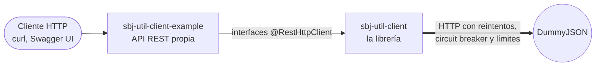

# sbj-util-client-annotation

Clientes REST **declarativos** para Spring Boot 4, con resiliencia integrada, y una aplicación de ejemplo que los
usa. Declaras una interfaz con las anotaciones de Spring Web que ya conoces y la librería genera el cliente:

```java
@RestHttpClient(url = "${users.url}", retry = @RetryConfig(maxRetries = 3))
public interface UsersClient {

    @GetMapping("/users/{id}")
    User find(@PathVariable("id") long id);

    @PostMapping("/users")
    User create(@RequestBody User user);
}
```

Este repositorio contiene dos proyectos Maven independientes:

| Proyecto | Qué es | Documentación |
|---|---|---|
| [`sbj-util-client`](sbj-util-client) | La **librería** (`io.github.programming0026.juniverse.client:juniverse-client-annotation`, versión 2.0.0). | [README](sbj-util-client/README.md) |
| [`sbj-util-client-example`](sbj-util-client-example) | Una **aplicación de ejemplo** que consume [DummyJSON](https://dummyjson.com) (productos, autenticación e imágenes) con arquitectura hexagonal y principios SOLID. | [README](sbj-util-client-example/README.md) |



## La librería

- **Anotaciones de Spring Web** (`@GetMapping`, `@PostMapping`, `@PathVariable`, `@RequestParam`,
  `@RequestHeader`, `@RequestBody`, `@RequestPart`...). La librería no define anotaciones HTTP propias.
- **Resiliencia con Resilience4j**: reintentos con backoff exponencial, circuit breaker, rate limiter y límite de
  tiempo, por cliente. Las peticiones no idempotentes (`POST`, `PATCH`) solo se reintentan si la conexión no llegó a
  establecerse, para no duplicar operaciones.
- **Se integra con Spring Boot**: autoconfiguración (no hace falta `@EnableRestHttpClients`), placeholders
  `${...}` desde `application.properties`, el Jackson de la aplicación, interceptores por cliente y métricas de
  Micrometer opcionales.
- **Falla al arrancar, no en producción**: cada cliente se valida al crear el contexto (URL, mappings, parámetros sin
  anotar, variables de la ruta) con mensajes que dicen qué corregir.
- **Retornos y parámetros flexibles**: genéricos (`List<T>`), `ResponseEntity<T>`, `void`, listas, arreglos y `Map`
  en parámetros, y subida de archivos con `MultipartFile`.
- **Cliente HTTP robusto**: Apache HttpClient 5 con pool de conexiones, timeouts de conexión y lectura, y SSL
  (keystore y truststore) configurables.
- **Sin dependencias de más**: no arrastra Tomcat, Spring MVC ni Spring Cloud a las aplicaciones que la usan.

Detalle completo (todas las opciones, ejemplos y el diagrama de clases) en el
[README de la librería](sbj-util-client/README.md).

## El ejemplo

Una API REST propia que, por dentro, llama a DummyJSON:

| Área | Qué se puede hacer |
|---|---|
| Productos | Listar, buscar, filtrar por categoría, paginar y ordenar; ver categorías; consultar, crear, modificar y eliminar |
| Autenticación | Iniciar sesión, consultar el usuario del token y renovar tokens |
| Imágenes | Generar imágenes png, jpg o webp con tamaño, colores y texto |

Está organizado en **dominio** (Java puro), **aplicación** (casos de uso y puertos) e **infraestructura**
(controladores y adaptadores), con pruebas automáticas que vigilan la regla de dependencias. Incluye
documentación Swagger. Detalle en el [README del ejemplo](sbj-util-client-example/README.md).

## Inicio rápido

Requisitos: **Java 21** y **Maven 3.9+** (los proyectos no incluyen Maven wrapper, usa tu `mvn`).

```bash
# 1. Instalar la librería en el repositorio local de Maven (el ejemplo depende de ella)
cd sbj-util-client
mvn clean install

# 2. Ejecutar el ejemplo
cd ../sbj-util-client-example
mvn spring-boot:run
```

Con el ejemplo en marcha:

| URL | Qué es |
|---|---|
| <http://localhost:8080/swagger-ui.html> | Swagger UI: documentación interactiva para probar cada endpoint |
| <http://localhost:8080/v3/api-docs> | El documento OpenAPI en JSON |
| <http://localhost:8080/api/products?limit=3> | Un ejemplo de consulta |

Para usar la librería en tu propio proyecto, tras instalarla agrégala como dependencia:

```xml
<dependency>
    <groupId>io.github.programming0026</groupId>
    <artifactId>sbj-util-client-annotation</artifactId>
    <version>2.0.0</version>
</dependency>
```

En una aplicación Spring Boot basta con declarar las interfaces `@RestHttpClient`: la autoconfiguración las
encuentra en los paquetes de la aplicación.

## Compilar y probar

Cada proyecto se compila por separado (no hay POM padre). Instala primero la librería: el ejemplo la necesita.

| Qué | Comando | Dónde |
|---|---|---|
| Compilar, probar y verificar la librería | `mvn clean verify` | `sbj-util-client` |
| Instalarla en el repositorio local | `mvn clean install` | `sbj-util-client` |
| Probar el ejemplo | `mvn test` | `sbj-util-client-example` |

- La librería exige **cobertura de pruebas mínima de 80 %** (JaCoCo) y pasar **checkstyle**; ambos corren en
  `mvn verify`.
- Las pruebas del ejemplo no necesitan internet: usan un servidor DummyJSON falso local.
- Si cambias el comportamiento de la librería, ejecuta también las pruebas del ejemplo: ya detectaron un error real
  de reintentos duplicados.

## Estructura del repositorio

```
sbj-util-client-annotation/
├── README.md                    Este archivo
├── LICENSE                      Licencia MIT
├── sbj-util-client/             La librería
│   ├── README.md                Documentación completa y diagrama de clases
│   ├── config/checkstyle.xml    Reglas de estilo
│   └── src/                     Código y pruebas
└── sbj-util-client-example/     La aplicación de ejemplo
    ├── README.md                Arquitectura, endpoints y pruebas del ejemplo
    └── src/                     Código y pruebas
```

## Licencia

[MIT](LICENSE).
