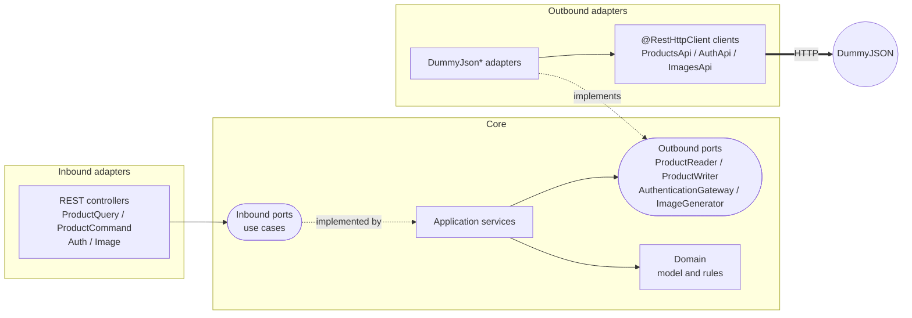

# sbj-util-client-example

[Español](README.md) | **English**

Example application for the [`sbj-util-client`](../sbj-util-client/README.en.md) library: its own REST API
that, internally, consumes the [DummyJSON](https://dummyjson.com) services (products, authentication and
images) with declarative clients, organized with **hexagonal architecture** and **SOLID** principles.

## Requirements

- Java 21 and Maven 3.9+
- The library installed in the local Maven repository (the example depends on `juniverse-client-annotation:2.0.0`):

```bash
cd ../sbj-util-client
mvn clean install
```

## How to run it

```bash
mvn spring-boot:run          # starts on http://localhost:8080
mvn test                     # 68 tests, no internet needed
```

The DummyJSON URL is configured in `src/main/resources/application.properties`:

```properties
dummyjson.base-url=https://dummyjson.com
```

## Swagger documentation (OpenAPI)

With the application running:

| URL | What it is |
|---|---|
| <http://localhost:8080/swagger-ui.html> | Swagger UI: interactive documentation to try each endpoint |
| <http://localhost:8080/v3/api-docs> | The OpenAPI document in JSON (also `/v3/api-docs.yaml`) |

To try the authenticated endpoint from Swagger UI:

1. Run **POST /api/auth/login** with `emilys` / `emilyspass` (already provided as an example in the body).
2. Copy the `accessToken` from the response.
3. Click **Authorize**, paste the token and confirm. From then on **GET /api/auth/me** sends it automatically
   in `Authorization: Bearer ...` (the UI remembers the token even if you reload the page).

How it is built (springdoc-openapi, dependency `springdoc-openapi-starter-webmvc-ui`):

- The general information (title, description, license and the `bearerAuth` security scheme) is in
  `infrastructure/config/OpenApiConfig`.
- Controllers are described with `@Tag`, `@Operation`, `@ApiResponse` and `@Parameter`, and request bodies
  with `@Schema` (examples included). These are **infrastructure** annotations: the domain and the application
  do not know about them, and `HexagonalArchitectureTest` enforces it.
- The documentation describes the example's **own** API. The `@RestHttpClient` clients towards DummyJSON are
  internal and do not appear.
- The `springdoc.*` properties in `application.properties` adjust the order and behavior of the UI.
- The documentation texts (Swagger UI) are in English, as are the error messages returned by the API (`detail`
  of the `ProblemDetail`s) and the logs.
- If you do not want to expose it (for example in production), add `springdoc.api-docs.enabled=false` and
  `springdoc.swagger-ui.enabled=false`.

## Endpoints

| Method | Path | What it does | DummyJSON service |
|---|---|---|---|
| `GET` | `/api/products` | Lists, searches (`q`) or filters (`category`), with `limit`, `skip`, `sortBy` and `order` | `/products`, `/products/search`, `/products/category/{slug}` |
| `GET` | `/api/products/categories` | Lists the categories | `/products/categories` |
| `GET` | `/api/products/{id}` | Gets a product | `/products/{id}` |
| `POST` | `/api/products` | Creates a product | `/products/add` |
| `PATCH` | `/api/products/{id}` | Modifies fields of a product | `/products/{id}` |
| `DELETE` | `/api/products/{id}` | Deletes a product | `/products/{id}` |
| `POST` | `/api/auth/login` | Logs in | `/auth/login` |
| `GET` | `/api/auth/me` | User of the token (`Authorization: Bearer ...`) | `/auth/me` |
| `POST` | `/api/auth/refresh` | Refreshes the tokens | `/auth/refresh` |
| `GET` | `/api/images` | Generates an image (`width`, `height`, `background`, `color`, `text`, `fontSize`, `format`) | `/image/{size}/{background}/{color}` |

> DummyJSON **simulates** creating, modifying and deleting: it responds as if it did, but nothing is stored.

```bash
# Products
curl "localhost:8080/api/products?limit=3&sortBy=price&order=desc"
curl "localhost:8080/api/products?q=phone"
curl "localhost:8080/api/products?category=laptops"
curl -X POST localhost:8080/api/products -H "Content-Type: application/json" \
     -d '{"title":"Lamp","price":12.5}'

# Authentication (DummyJSON test user)
curl -X POST localhost:8080/api/auth/login -H "Content-Type: application/json" \
     -d '{"username":"emilys","password":"emilyspass"}'
curl localhost:8080/api/auth/me -H "Authorization: Bearer <accessToken>"

# Images
curl "localhost:8080/api/images?width=400&height=200&background=008080&color=ffffff&text=Hello&format=webp" -o image.webp
```

Errors are returned as `ProblemDetail` (RFC 9457): `400` invalid data, `401` invalid credentials or token,
`404` nonexistent product and `503` if DummyJSON is unavailable.

## Hexagonal architecture

The core (domain and application) knows nothing about Spring, HTTP or DummyJSON. Dependency arrows always
point inwards:



```
com.juniverse.client.example
├── domain/                         Plain Java: model, validations and business exceptions
│   ├── model/                      Product, ProductCriteria, ImageSpec, Credentials, ...
│   └── exception/                  ProductNotFoundException, InvalidRequestException, ...
├── application/
│   ├── port/in/                    Use cases (one interface per use case)
│   ├── port/out/                   What the application needs from the outside
│   └── service/                    Use case implementations (no Spring annotations)
└── infrastructure/
    ├── adapter/in/web/             REST API: controllers (with their OpenAPI documentation), DTOs and errors to HTTP
    ├── adapter/out/dummyjson/      DummyJSON adapters, DTOs, mapper and error translator
    │   └── api/                    @RestHttpClient interfaces (implemented by the library)
    └── config/                     Use case wiring (UseCaseConfig) and OpenAPI information
```

An automated test (`HexagonalArchitectureTest`) checks the rule: the domain imports nothing from Spring or
from other layers, the application depends only on the domain, and the inbound and outbound adapters do not
know each other.

## How it uses the library

The three clients are just interfaces (`infrastructure/adapter/out/dummyjson/api`). There is no
`@EnableRestHttpClients`: Spring Boot's auto-configuration finds the `@RestHttpClient` interfaces in the
application's package.

```java
@RestHttpClient(
        name = "dummyJsonProducts",
        url = "${dummyjson.base-url}/products",           // placeholder resolved from application.properties
        retry = @RetryConfig(maxRetries = 3, retryDelay = 300),
        circuitBreaker = @CircuitBreakerConfig(enabled = true, minimumNumberOfCalls = 10),
        timeLimiter = @TimeLimiterConfig(enabled = true, timeout = 15000),
        interceptors = LoggingInterceptor.class)           // custom interceptor, with dependency injection
public interface ProductsApi {

    @GetMapping("/search")
    ProductListDto search(@RequestParam("q") String query, @RequestParam("limit") int limit,
                          @RequestParam("skip") int skip,
                          @RequestParam(name = "sortBy", required = false) String sortBy,
                          @RequestParam(name = "order", required = false) String order);
    // ...
}
```

What it takes advantage of from the library:

- **Spring Web annotations** (`@GetMapping`, `@PathVariable`, `@RequestParam`, `@RequestBody`,
  `@RequestHeader`) and optional parameters (`required = false`).
- **Generics and `ResponseEntity<T>`** as return types: `List<CategoryDto>` and `ResponseEntity<byte[]>`
  (images keep their content type).
- **Resilience**: retries, circuit breaker and time limit. The `POST`s of `/auth` and of product creation are
  not idempotent, so they are retried only if the connection was never even established.
- **Startup validation**: if an interface is declared incorrectly, the application does not start.
- **Per-client interceptor** (`LoggingInterceptor`): logs method, URL, status and duration, without touching
  headers or bodies so tokens are not leaked.
- **The application's Jackson**: the clients use Spring Boot's message converters.

### DummyJSON details the example handles

- Numeric fields in the DTOs are wrapper types (`Long`, `Double`, `Integer`): DummyJSON omits fields in the
  create and modify responses, and Jackson 3 rejects a missing primitive.
- A `400` on login means invalid credentials; a `403` on refresh means an invalid token. The adapter
  translates each code into its business meaning.
- For invalid sizes or colors, the image service responds with an HTML page. That is why the domain validates
  them before calling it (`ImageSpec`).

## Tests

| Test | What it verifies |
|---|---|
| `domain/model/*Test` | The domain rules: ranges, default values, validations and that secrets do not show up in `toString`. |
| `application/service/*Test` | The use cases with doubles of the outbound ports (no Spring or network). |
| `HexagonalArchitectureTest` | The dependency rule between layers (including that the domain and the application do not use Spring or OpenAPI). |
| `OpenApiDocumentationTest` | That the OpenAPI document describes all endpoints, parameters, responses, image types and the Bearer scheme, and that Swagger UI is available. |
| `DummyJsonIntegrationTest` | End to end: the full Spring application against a local fake DummyJSON (`FakeDummyJsonServer`), including retries and errors. |

## How to extend it

To consume another DummyJSON service (for example `/carts` or `/users`):

1. Model and rules in `domain`.
2. An inbound port (use case) and an outbound one in `application.port`, and the service in
   `application.service`.
3. A `@RestHttpClient` interface, its DTOs and an adapter in `adapter/out/dummyjson`.
4. A controller in `adapter/in/web` and the service's `@Bean` in `UseCaseConfig`.
