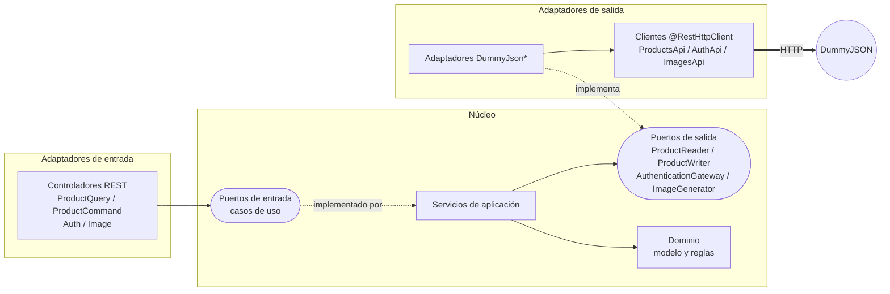

# sbj-util-client-example

Aplicación de ejemplo de la librería [`sbj-util-client`](../sbj-util-client): una API REST propia que, por
dentro, consume los servicios de [DummyJSON](https://dummyjson.com) (productos, autenticación e imágenes) con
clientes declarativos, y está organizada con **arquitectura hexagonal** y principios **SOLID**.

## Requisitos

- Java 21 y Maven 3.9+
- La librería instalada en el repositorio local de Maven (el ejemplo depende de `sbj-util-client:2.0.0`):

```bash
cd ../sbj-util-client
mvn clean install
```

## Cómo ejecutarlo

```bash
mvn spring-boot:run          # arranca en http://localhost:8080
mvn test                     # 68 tests, sin necesidad de internet
```

La URL de DummyJSON se configura en `src/main/resources/application.properties`:

```properties
dummyjson.base-url=https://dummyjson.com
```

## Documentación Swagger (OpenAPI)

Con la aplicación en marcha:

| URL | Qué es |
|---|---|
| <http://localhost:8080/swagger-ui.html> | Swagger UI: documentación interactiva para probar cada endpoint |
| <http://localhost:8080/v3/api-docs> | El documento OpenAPI en JSON (también `/v3/api-docs.yaml`) |

Para probar el endpoint autenticado desde Swagger UI:

1. Ejecuta **POST /api/auth/login** con `emilys` / `emilyspass` (ya vienen como ejemplo en el cuerpo).
2. Copia el `accessToken` de la respuesta.
3. Pulsa **Authorize**, pega el token y confirma. A partir de ahí **GET /api/auth/me** lo envía solo en
   `Authorization: Bearer ...` (la interfaz recuerda el token aunque recargues la página).

Cómo está hecho (springdoc-openapi, dependencia `springdoc-openapi-starter-webmvc-ui`):

- Los datos generales (título, descripción, licencia y el esquema de seguridad `bearerAuth`) están en
  `infrastructure/config/OpenApiConfig`.
- Los controladores se describen con `@Tag`, `@Operation`, `@ApiResponse` y `@Parameter`, y los cuerpos de
  petición con `@Schema` (ejemplos incluidos). Son anotaciones de la **infraestructura**: el dominio y la
  aplicación no las conocen, y `HexagonalArchitectureTest` lo vigila.
- La documentación describe la API **propia** del ejemplo. Los clientes `@RestHttpClient` hacia DummyJSON son
  internos y no aparecen.
- Las propiedades `springdoc.*` de `application.properties` ajustan el orden y el comportamiento de la interfaz.
- Los textos de la documentación están en español; los mensajes de error que devuelve la API (`detail` de los
  `ProblemDetail`) están en inglés, igual que los logs.
- Si no quieres exponerla (por ejemplo en producción), añade `springdoc.api-docs.enabled=false` y
  `springdoc.swagger-ui.enabled=false`.

## Endpoints

| Método | Ruta | Qué hace | Servicio de DummyJSON |
|---|---|---|---|
| `GET` | `/api/products` | Lista, busca (`q`) o filtra (`category`), con `limit`, `skip`, `sortBy` y `order` | `/products`, `/products/search`, `/products/category/{slug}` |
| `GET` | `/api/products/categories` | Lista las categorías | `/products/categories` |
| `GET` | `/api/products/{id}` | Consulta un producto | `/products/{id}` |
| `POST` | `/api/products` | Crea un producto | `/products/add` |
| `PATCH` | `/api/products/{id}` | Modifica campos de un producto | `/products/{id}` |
| `DELETE` | `/api/products/{id}` | Elimina un producto | `/products/{id}` |
| `POST` | `/api/auth/login` | Inicia sesión | `/auth/login` |
| `GET` | `/api/auth/me` | Usuario del token (`Authorization: Bearer ...`) | `/auth/me` |
| `POST` | `/api/auth/refresh` | Renueva los tokens | `/auth/refresh` |
| `GET` | `/api/images` | Genera una imagen (`width`, `height`, `background`, `color`, `text`, `fontSize`, `format`) | `/image/{size}/{background}/{color}` |

> DummyJSON **simula** crear, modificar y eliminar: responde como si lo hiciera, pero no guarda nada.

```bash
# Productos
curl "localhost:8080/api/products?limit=3&sortBy=price&order=desc"
curl "localhost:8080/api/products?q=phone"
curl "localhost:8080/api/products?category=laptops"
curl -X POST localhost:8080/api/products -H "Content-Type: application/json" \
     -d '{"title":"Lámpara","price":12.5}'

# Autenticación (usuario de prueba de DummyJSON)
curl -X POST localhost:8080/api/auth/login -H "Content-Type: application/json" \
     -d '{"username":"emilys","password":"emilyspass"}'
curl localhost:8080/api/auth/me -H "Authorization: Bearer <accessToken>"

# Imágenes
curl "localhost:8080/api/images?width=400&height=200&background=008080&color=ffffff&text=Hola&format=webp" -o imagen.webp
```

Los errores se devuelven como `ProblemDetail` (RFC 9457): `400` datos inválidos, `401` credenciales o token
inválidos, `404` producto inexistente y `503` si DummyJSON no está disponible.

## Arquitectura hexagonal

El núcleo (dominio y aplicación) no conoce Spring, HTTP ni DummyJSON. Las flechas de dependencia siempre
apuntan hacia adentro:



```
com.juniverse.client.example
├── domain/                         Java puro: modelo, validaciones y excepciones de negocio
│   ├── model/                      Product, ProductCriteria, ImageSpec, Credentials, ...
│   └── exception/                  ProductNotFoundException, InvalidRequestException, ...
├── application/
│   ├── port/in/                    Casos de uso (una interfaz por caso de uso)
│   ├── port/out/                   Lo que la aplicación necesita del exterior
│   └── service/                    Implementación de los casos de uso (sin anotaciones de Spring)
└── infrastructure/
    ├── adapter/in/web/             API REST: controladores (con su documentación OpenAPI), DTOs y errores a HTTP
    ├── adapter/out/dummyjson/      Adaptadores, DTOs, mapper y traductor de errores de DummyJSON
    │   └── api/                    Interfaces @RestHttpClient (las genera la librería)
    └── config/                     Ensamblado de los casos de uso (UseCaseConfig) y datos de OpenAPI
```

Una prueba automática (`HexagonalArchitectureTest`) comprueba la regla: el dominio no importa nada de
Spring ni de otras capas, la aplicación solo depende del dominio y los adaptadores de entrada y de salida no
se conocen entre sí.

## Principios SOLID en el ejemplo

| Principio | Dónde se ve |
|---|---|
| **S**: responsabilidad única | `ProductQueryService` (consultas) y `ProductCommandService` (cambios) son clases distintas; `DummyJsonMapper` solo convierte; `DummyJsonErrorTranslator` solo traduce errores; `WebExceptionHandler` es el único que conoce los códigos HTTP. |
| **O**: abierto/cerrado | Para cambiar de proveedor basta un adaptador nuevo que implemente el puerto; los servicios y controladores no se modifican. |
| **L**: sustitución de Liskov | Cualquier implementación de `ProductReader` (DummyJSON, base de datos, un doble de pruebas) es intercambiable: los tests de los servicios usan dobles. |
| **I**: segregación de interfaces | Un puerto de entrada por caso de uso, y la lectura (`ProductReader`) separada de la escritura (`ProductWriter`). |
| **D**: inversión de dependencias | Los servicios dependen de los puertos de salida (interfaces del núcleo), no de los adaptadores; `UseCaseConfig` es el único lugar que decide qué adaptador se usa. |

## Cómo usa la librería

Los tres clientes son solo interfaces (`infrastructure/adapter/out/dummyjson/api`). No hay
`@EnableRestHttpClients`: la autoconfiguración de Spring Boot encuentra las interfaces `@RestHttpClient` del
paquete de la aplicación.

```java
@RestHttpClient(
        name = "dummyJsonProducts",
        url = "${dummyjson.base-url}/products",           // placeholder resuelto desde application.properties
        retry = @RetryConfig(maxRetries = 3, retryDelay = 300),
        circuitBreaker = @CircuitBreakerConfig(enabled = true, minimumNumberOfCalls = 10),
        timeLimiter = @TimeLimiterConfig(enabled = true, timeout = 15000),
        interceptors = LoggingInterceptor.class)           // interceptor propio, con inyección de dependencias
public interface ProductsApi {

    @GetMapping("/search")
    ProductListDto search(@RequestParam("q") String query, @RequestParam("limit") int limit,
                          @RequestParam("skip") int skip,
                          @RequestParam(name = "sortBy", required = false) String sortBy,
                          @RequestParam(name = "order", required = false) String order);
    // ...
}
```

Lo que se aprovecha de la librería:

- **Anotaciones de Spring Web** (`@GetMapping`, `@PathVariable`, `@RequestParam`, `@RequestBody`,
  `@RequestHeader`) y parámetros opcionales (`required = false`).
- **Genéricos y `ResponseEntity<T>`** como tipo de retorno: `List<CategoryDto>` y `ResponseEntity<byte[]>`
  (las imágenes conservan su tipo de contenido).
- **Resiliencia**: reintentos, circuit breaker y límite de tiempo. Los `POST` de `/auth` y de crear producto no
  son idempotentes, así que solo se reintentan si la conexión ni siquiera se estableció.
- **Validación al arrancar**: si una interfaz está mal declarada, la aplicación no arranca.
- **Interceptor por cliente** (`LoggingInterceptor`): registra método, URL, estado y duración, sin tocar
  cabeceras ni cuerpos para no filtrar tokens.
- **Jackson de la aplicación**: los clientes usan los message converters de Spring Boot.

### Detalles de DummyJSON que el ejemplo resuelve

- Los campos numéricos de los DTO son tipos envoltorio (`Long`, `Double`, `Integer`): DummyJSON omite campos en
  las respuestas de crear y modificar, y Jackson 3 rechaza un primitivo ausente.
- Un `400` al iniciar sesión significa credenciales inválidas; un `403` al renovar significa token inválido. El
  adaptador traduce cada código a su significado de negocio.
- Ante tamaños o colores inválidos, el servicio de imágenes responde una página HTML. Por eso el dominio los
  valida antes de llamarlo (`ImageSpec`).

## Pruebas

| Prueba | Qué verifica |
|---|---|
| `domain/model/*Test` | Las reglas del dominio: rangos, valores por defecto, validaciones y que los secretos no salgan en `toString`. |
| `application/service/*Test` | Los casos de uso con dobles de los puertos de salida (sin Spring ni red). |
| `HexagonalArchitectureTest` | La regla de dependencias entre capas (incluido que el dominio y la aplicación no usan Spring ni OpenAPI). |
| `OpenApiDocumentationTest` | Que el documento OpenAPI describe todos los endpoints, parámetros, respuestas, tipos de imagen y el esquema Bearer, y que Swagger UI está disponible. |
| `DummyJsonIntegrationTest` | De punta a punta: la aplicación completa de Spring contra un DummyJSON falso local (`FakeDummyJsonServer`), incluidos reintentos y errores. |

## Cómo extenderlo

Para consumir otro servicio de DummyJSON (por ejemplo `/carts` o `/users`):

1. Modelo y reglas en `domain`.
2. Un puerto de entrada (caso de uso) y uno de salida en `application.port`, y el servicio en
   `application.service`.
3. Una interfaz `@RestHttpClient`, sus DTOs y un adaptador en `adapter/out/dummyjson`.
4. Un controlador en `adapter/in/web` y el `@Bean` del servicio en `UseCaseConfig`.
