# sbj-util-client

[Español](README.md) | **English**

A library for declaring **REST clients as interfaces** in Spring Boot 4, with built-in Resilience4j
resilience patterns (retry, circuit breaker, rate limiter and time limiter).

Methods are described with the same Spring Web annotations used in controllers (`@GetMapping`,
`@PathVariable`, `@RequestParam`, etc.); the library generates a proxy that makes the request with
`RestClient` or `RestTemplate` on top of Apache HttpClient 5.

## Requirements

- Java 21
- **Spring Boot 4.x**: the library uses the Spring Framework 7 and Jackson 3 APIs, so it
  **does not work with applications on Spring Boot 3.x or earlier**.
- Maven 3.9+

## Installation

Install the library in your local repository:

```bash
mvn clean install
```

And add it as a dependency:

```xml
<dependency>
    <groupId>io.github.programming0026</groupId>
    <artifactId>sbj-util-client-annotation</artifactId>
    <version>2.0.0</version>
</dependency>
```

## Quick start

1. In a **Spring Boot** application nothing needs to be configured: auto-configuration registers every
   `@RestHttpClient` interface in the application's packages (those of the class annotated with
   `@SpringBootApplication`). To choose the packages, or without Spring Boot, use `@EnableRestHttpClients` on
   a configuration class (without `basePackages`, the package of that class is scanned):

```java
@Configuration
@EnableRestHttpClients(basePackages = "com.mycompany.clients")
public class ClientsConfig {
}
```

   With `@EnableRestHttpClients` automatic scanning is turned off; it can also be turned off with
   `rest-http-client.auto-scan.enabled=false`.

2. Declare the client:

```java
@RestHttpClient(name = "userClient", url = "https://api.example.com")
public interface UserClient {

    @GetMapping(value = "/users/{id}", headers = "X-App=demo")
    User getUser(@PathVariable("id") long id);

    @GetMapping("/users")
    List<User> search(@RequestParam(name = "page", defaultValue = "1") int page,
                      @RequestParam(name = "tag", required = false) List<String> tags);

    @PostMapping(path = "/users", consumes = MediaType.APPLICATION_JSON_VALUE)
    User create(@RequestBody User user, @RequestHeader("X-Trace") String traceId);
}
```

3. Inject it like any other bean:

```java
@Service
public class UserService {

    private final UserClient userClient;

    public UserService(UserClient userClient) {
        this.userClient = userClient;
    }
}
```

The bean name is `name()` or, if empty, the interface name with its first letter in lower case
(`userClient`).

## Method annotations

`@GetMapping`, `@PostMapping`, `@PutMapping`, `@PatchMapping`, `@DeleteMapping` and
`@RequestMapping(method = ...)` are supported.

| Attribute | How it is used |
|---|---|
| `value` / `path` | Path relative to `url()` (joined with a single `/`). Only one path is supported. |
| `method` | HTTP method. Only one is supported. |
| `headers` | Fixed headers in Spring's `"Name=value"` format. Conditions without a value (`"Name"`, `"!Name"`, `"Name!=value"`) are ignored with a warning. |
| `params` | Fixed query params in the `"name=value"` format (conditions without a value are ignored with a warning). |
| `produces` | Sent as the `Accept` header. |
| `consumes` | The first value is sent as the `Content-Type` header. |

A `@RequestMapping` on the **interface** provides a path prefix and default values for `headers`,
`params`, `produces`, `consumes` and `method`; those on the method complement or replace them:

```java
@RestHttpClient(url = "${api.url}")
@RequestMapping(path = "/v1", headers = "X-Client=inventory", params = "tenant=acme")
public interface InventoryClient {

    @GetMapping("/stock")          // GET {api.url}/v1/stock?tenant=acme with X-Client: inventory
    Stock stock();
}
```

`default` (and `static`) interface methods run normally, without an HTTP request, and
`equals`/`hashCode`/`toString` use the proxy's identity.

### Startup validation

Each client is validated **when the context starts**, even if no bean injects it: if something is declared
incorrectly, the application does not start and the `ClientException` says which method and which parameter
to fix. The following are rejected:

- an empty `url`, or one that is not an absolute `http(s)://host` (after resolving placeholders);
- a method without a mapping annotation, without an HTTP method, or with more than one path or HTTP method;
- a parameter without `@PathVariable`, `@RequestParam`, `@RequestHeader`, `@CookieValue`, `@RequestBody` or `@RequestPart`;
- more than one `@RequestBody`, or a `@RequestBody` together with a `@RequestPart`;
- a `@RequestPart` on a method whose `consumes` is not `multipart/form-data`;
- a path variable (`{id}`) without its `@PathVariable`, or a `@PathVariable` that does not appear in the path
  (except with `@PathVariable Map`, which provides the variables at call time);
- an unsupported return type (see [Return types](#return-types)): `Future`, `CompletableFuture`,
  `CompletionStage`, reactive types (`Mono`, `Flux`, ...), `java.util.stream.Stream` and subclasses of
  `InputStream`. The body type inside `ResponseEntity<...>` is validated too.

The annotations of each method are analyzed only once, when the client is created (the placeholders of the
mapping and of `defaultValue` too); on each call only the arguments are bound.

### Return types

| Return type | Result |
|---|---|
| `T` (including generics such as `List<User>`) | The body converted to `T`, keeping the generics. |
| `ResponseEntity<T>` | The full response (status, headers and body). |
| `void` / `ResponseEntity<Void>` | The body is not read. |
| `InputStream` / `ResponseEntity<InputStream>` | The **unread** body, to process it progressively (see [Downloads](#downloads-inputstream)). |

If the method returns a primitive (`int`, `boolean`, ...) and the response has no body, a
`ClientException` is thrown.

Clients are synchronous and imperative, so `Future`, `CompletableFuture`, `CompletionStage`, reactive types
(`Mono`, `Flux`) and `Stream` are rejected at startup with a message suggesting the alternative (return the
value directly and call the method from your own executor if you need asynchrony).

### Downloads (`InputStream`)

With `Resource` or `byte[]` the whole body is loaded into memory. For large files return an
`InputStream`: the call returns as soon as the headers arrive and you read the body at your own pace.

```java
@GetMapping("/reports/{id}")
ResponseEntity<InputStream> report(@PathVariable String id);

try (InputStream in = client.report("42").getBody()) {
    Files.copy(in, destination, StandardCopyOption.REPLACE_EXISTING);
}
```

Rules:

- **Always close the stream** (`try-with-resources`): while it is open it holds a connection from the pool.
  Reading it to the end also releases it; closing it several times is harmless.
- Only with `type = ClientType.REST_CLIENT`; with `REST_TEMPLATE` it is rejected at startup (it closes the
  response before returning).
- `4xx`/`5xx` errors are still exceptions (with the `ErrorHandler`), and retries, circuit breaker, rate limiter
  and time limiter apply **until the headers arrive**; after that, reading the body is no longer protected by
  them.
- `readTimeout` applies to each read: a stalled download fails with `SocketTimeoutException` instead of
  hanging, even if the full download takes longer.
- **Closing the stream before reading it fully still downloads the rest of the body** (the HTTP client consumes
  it so it can reuse the connection): measured, closing after reading 1 KB of a 3 s response took 3.7 s. If you
  need to cancel huge downloads, keep this cost in mind.

## Parameter annotations

| Annotation | Sent as |
|---|---|
| `@PathVariable` | Path variable (`{id}`). |
| `@RequestParam` | Query param. |
| `@RequestHeader` | Header; replaces the one with the same name declared in the mapping's `headers`. |
| `@CookieValue` | A `name=value` pair of the `Cookie` header. |
| `@RequestBody` | Request body. |
| `@RequestPart` | A part of a `multipart/form-data` request (files, see "Files and multipart"). |

- **Name:** `name`/`value` is used; if not given, the Java parameter name (requires compiling with
  `-parameters`, which `spring-boot-starter-parent` already enables).
- **`null` or empty values:** `defaultValue` is used if present; if `required = false` it is omitted; if it is
  required a `ClientException` is thrown. A `@PathVariable` without a value always throws an error, and a
  `null` `@RequestBody` is only allowed with `required = false`.
- **Encoding:** each value is encoded only once in the URL (`a&b` → `a%26b`, `a b/c` → `a%20b%2Fc`).
- **Date and number format:** with `@DateTimeFormat` or `@NumberFormat` on the parameter (`@PathVariable`,
  `@RequestParam`, `@RequestHeader`, `@CookieValue`; also on list elements and on `Map` values) the value is
  formatted with Spring's `ConversionService`:
  `@RequestParam("d") @DateTimeFormat(pattern = "dd/MM/yyyy") LocalDate d` sends `d=08%2F11%2F2026`, and
  `@DateTimeFormat(iso = DateTimeFormat.ISO.DATE)` or `@NumberFormat(pattern = "#,##0.00")` work the same way.
  Without those annotations nothing changes: `String.valueOf` is used (ISO-8601 dates, numbers without
  separators). The format depends on the JVM's default `Locale` only if the pattern uses it (month names,
  separators).
- **Cookies:** all `@CookieValue`s are joined into a single `Cookie` header (`session=abc; theme=dark`), in
  parameter order and after the cookies declared by `headers = "Cookie=..."` in the mapping. Lists and `Map`s
  contribute one pair per value/entry. The value is sent as is (not encoded) and rejected if it contains `;` or
  line breaks. It is a cookie for **this request**: the library does not store the cookies returned by the
  server (`Set-Cookie`).

### Lists and arrays

`List`, `Set`, any `Iterable` and arrays (including primitive ones such as `int[]`) are expanded.
`null` elements are skipped and an empty list counts as a missing value.

| Annotation | Example | Result |
|---|---|---|
| `@RequestParam` | `List.of("a", "b")` | `?tag=a&tag=b` |
| `@RequestHeader` | `new String[]{"admin", "user"}` | header with two values |
| `@PathVariable` | `List.of(1, 2, 3)` | `/items/1%2C2%2C3` (joined with commas) |

### Map

A parameter declared as `Map` or `MultiValueMap` contributes one entry per key (the annotation's name is
ignored):

```java
@GetMapping("/items")
String search(@RequestParam Map<String, Object> filters);
// {q: "a&b", tag: [x, y], page: 2}  →  /items?q=a%26b&tag=x&tag=y&page=2

@GetMapping("/orgs/{org}/items/{id}")
String byPath(@PathVariable Map<String, Object> variables);
```

Entries with a `null` key, a `null` value or an empty list are skipped. Only a `null` map counts as
missing; an empty map sends nothing.

### Files and multipart

To upload files or send `multipart/form-data` forms, each part is a `@RequestPart` parameter.
There is no need to declare `consumes`: the library sets `Content-Type: multipart/form-data` (and Spring adds
the `boundary`). If you declare it, it must be `multipart/form-data`.

```java
@RestHttpClient(url = "${files.url}")
public interface FilesClient {

    @PostMapping("/documents")
    DocumentResponse upload(@RequestPart("file") MultipartFile file,
                            @RequestPart("description") String description,
                            @RequestPart("metadata") Metadata metadata);   // sent as a JSON part

    @PostMapping("/batch")
    void uploadAll(@RequestPart("files") List<MultipartFile> files);  // one part per file
}
```

| Parameter type | How it is sent |
|---|---|
| `MultipartFile` | File, with its original name and content type. |
| `File`, `Path` | File, with the name of the file on disk. |
| `Resource` (for example `ByteArrayResource`, `FileSystemResource`) | File; the name and type come from `getFilename()`. |
| `byte[]` | Binary part (`application/octet-stream`) without a file name; use a `Resource` if the server requires one. |
| `String`, numbers, `boolean`, enums | Text part. |
| Any other object (classes, records) | `application/json` part. |
| `List`, `Set` or array of the above | One part per element, all with the same name. |

- A `null` part or an empty list is omitted if `required = false`; if it is required, it throws `ClientException`.
- They can be combined with `@RequestParam`, `@RequestHeader` and `@PathVariable`, but **not** with `@RequestBody`.
- `MultipartFile` comes from `spring-web` (no servlet server needed). `FilePart` belongs to Spring WebFlux
  (reactive) and is not supported: the library is imperative. To forward a file received through WebFlux,
  convert it to `Resource` or `byte[]` first.
- Manual alternative: `@RequestBody MultiValueMap<String, Object>` with `consumes = MULTIPART_FORM_DATA_VALUE`.
- A `POST` is not retried after an HTTP error or a timeout (see "Resilience"), so a file is not uploaded
  twice by accident.

## Client configuration

Everything is configured in `@RestHttpClient`:

| Attribute | Default | Description |
|---|---|---|
| `url` | `""` | Base URL of the service. |
| `type` | `REST_CLIENT` | `REST_CLIENT` or `REST_TEMPLATE`. |
| `connectTimeout` | `5000` | Maximum time to open the TCP connection and to obtain a free connection from the pool (ms). |
| `readTimeout` | `30000` | Maximum time to wait for the response once connected (ms). |
| `maxConnections` | `100` | Total connections in the pool. |
| `maxConnectionsPerRoute` | `20` | Connections per route. |
| `connectionTimeToLive` | `-1` | Connection time to live (ms); `-1` for no limit. |
| `ssl` | `@SSLConfig` | Keystore and truststore. |
| `followRedirects`, `maxRedirects` | `boolean`, `int` | Whether redirects are followed (`true`) and how many (50). |
| `proxy` | `@ProxyConfig` | HTTP/HTTPS proxy with authentication and `nonProxyHosts`. |
| `retry`, `circuitBreaker`, `rateLimiter`, `timeLimiter` | | Resilience (see below). |
| `errorHandler` | `DefaultErrorHandler` | Handling of error responses. |
| `fallback` | `void.class` (none) | Class that responds when the service is unavailable (see "Fallback"). |
| `interceptors` | `{}` | The client's own interceptors (see "Interceptors"). |
| `logging` | `false` | Logs each request (method, URL, status, duration); see "Request logging". |
| `jsonConfig` | `JsonMapperConfigurer` | Customizes the client's JSON (Jackson 3); see "Per-client JSON". |

## Property placeholders

Text attributes support `${...}` placeholders that are resolved with Spring's `Environment`
(`application.properties`/`.yml`, environment variables, system properties), with an optional default value
`${key:value}`:

```java
@RestHttpClient(name = "${clients.payments.name:paymentsClient}", url = "${clients.payments.url}",
        ssl = @SSLConfig(keystorePath = "${clients.payments.keystore}", keystorePassword = "${KEYSTORE_PASSWORD}"))
public interface PaymentsClient {

    @GetMapping(path = "${clients.payments.version:/v1}/payments", headers = "X-Api-Key=${clients.payments.api-key}")
    List<Payment> list(@RequestParam(name = "size", defaultValue = "${clients.payments.page-size:20}") int size);
}
```

- Resolved: all text attributes of `@RestHttpClient` and its nested annotations (`name`, `url`, `@SSLConfig`
  paths and passwords), `basePackages` of `@EnableRestHttpClients`, and on methods `path`, `headers`,
  `produces`, `consumes` and the `defaultValue` of `@RequestParam`/`@RequestHeader`.
- A placeholder with no value and no default makes startup fail (like `@Value`).
- Numeric or boolean attributes (timeouts, `maxRetries`, `enabled`, etc.) do not support placeholders because
  Java requires constants of that type in annotations.

## Resilience

The decorators are applied in the order recommended by Resilience4j:
**Retry (outermost) → CircuitBreaker → RateLimiter → TimeLimiter → request**. This way each attempt goes
through the circuit breaker, consumes a rate limiter permit and has its own time limit.

```java
@RestHttpClient(
        url = "https://api.example.com",
        retry = @RetryConfig(maxRetries = 3, retryDelay = 500, exponentialBackoffMultiplier = 2.0,
                             retryNonIdempotent = false),
        circuitBreaker = @CircuitBreakerConfig(enabled = true, failureRateThreshold = 50),
        rateLimiter = @RateLimiterConfig(enabled = true, limitForPeriod = 100, limitRefreshPeriod = 1000),
        timeLimiter = @TimeLimiterConfig(enabled = true, timeout = 2000))
public interface PaymentsClient { ... }
```

- **Retry:** always active. `maxRetries` is the total number of attempts (including the first one). HTTP
  errors are retried only if `ErrorHandler.shouldRetry` allows it; timeouts and network errors always are.
  There is no retry if the circuit is open (`CallNotPermittedException`), if the rate limiter rejects the call
  (`RequestNotPermitted`) or on other `ClientException`s (configuration or usage errors).
- **`POST` and `PATCH` (non-idempotent):** to avoid duplicating operations, they are retried only when the
  connection fails (connection refused, connect timeout or pool without free connections), because in that case
  the request never reached the server. After an HTTP error (even 502/503/504), a timeout or a dropped
  connection they are not retried. If the service does treat them idempotently (for example, with an
  idempotency key), `@RetryConfig(retryNonIdempotent = true)` retries them just like `GET`, `PUT` or `DELETE`.
- **Circuit breaker:** whatever `ErrorHandler.shouldRecordAsFailure` indicates counts as a failure (5xx by
  default), plus timeouts and network errors; 4xx do not open the circuit.
- **No hidden retries:** the Apache HttpClient client is created with its automatic retries disabled. The only
  retries are those of `@RetryConfig`, so `maxRetries` is exact and `ErrorHandler.shouldRetry` always decides
  (with HttpClient's default strategy, each GET with a 503 was repeated on its own after 1 s).
- **Circuit breaker, rate limiter and time limiter:** disabled by default (`enabled = false`).
- **Timeout:** if an attempt exceeds the time limiter, the request is interrupted and a `ClientException` is
  thrown with a `TimeoutException` as its cause (and it is retried according to `retry`). Requests with a time
  limiter run on virtual threads, not on the common `ForkJoinPool`.

### Per-method settings (`@MethodConfig`)

The client's timeouts and retries apply to all its methods. With `@MethodConfig` a method can override them
just for itself; whatever you leave out is inherited from the client:

```java
@RestHttpClient(url = "${reports.url}", readTimeout = 5_000,
        retry = @RetryConfig(maxRetries = 3))
public interface ReportsClient {

    @GetMapping("/summary")
    Summary summary();                     // 5 s wait, 3 attempts (the client's)

    @GetMapping("/export/{id}")
    @MethodConfig(readTimeout = 120_000, maxRetries = 1, timeLimiterTimeout = 0)
    InputStream export(@PathVariable String id);   // 2 min wait, no retries, no time limit
}
```

| Attribute | Overrides | Values |
|---|---|---|
| `readTimeout` | `@RestHttpClient.readTimeout` (ms) | `> 0`; `-1` (default) inherits. With `InputStream` it also governs each body read. |
| `maxRetries` | `@RetryConfig.maxRetries` (total attempts) | `>= 1` (`1` = no retries); `-1` inherits. Delay, backoff and `retryNonIdempotent` are inherited. |
| `timeLimiterTimeout` | `@TimeLimiterConfig.timeout` (ms) | `> 0` sets that limit even if the client has no time limiter; `0` removes it for the method; `-1` inherits. |

- The circuit breaker and the rate limiter still belong to the whole client (all methods share their state).
- An out-of-range value makes startup fail with a `ClientException` naming the method and the attribute.
- If a method has a `readTimeout` greater than the time limit that applies to it (the client's, if any), the
  limit cuts first: raise `timeLimiterTimeout` too, or set it to `0`.
- Each method with retry or time limiter settings has its own Resilience4j instances (named
  `Client#method(Types)`), which appear under that name in the metrics.

## Interceptors

To add logic to every request of a client (authentication, logging, tracing), declare
`ClientHttpRequestInterceptor`s in `interceptors`. Just like with the `ErrorHandler`, if a bean of that type
exists it is used; otherwise Spring creates the instance with dependency injection:

```java
@Component
class AuthInterceptor implements ClientHttpRequestInterceptor {

    private final TokenProvider tokens;

    AuthInterceptor(TokenProvider tokens) {
        this.tokens = tokens;
    }

    @Override
    public ClientHttpResponse intercept(HttpRequest request, byte[] body, ClientHttpRequestExecution execution)
            throws IOException {
        request.getHeaders().setBearerAuth(tokens.token());
        return execution.execute(request, body);
    }
}

@RestHttpClient(url = "${payments.url}", interceptors = {AuthInterceptor.class, TraceInterceptor.class})
public interface PaymentsClient { ... }
```

They run in the declared order and **after** the application's global interceptors (those of the
`RestClientCustomizer`s or the `RestTemplateBuilder`).

### Request logging

To see what each client calls you do not need to write an interceptor: `@RestHttpClient(logging = true)`.

```
INFO  io.github.programming0026.juniverse.client.http.payments : GET https://payments.internal.com/charges?from&limit -> 200 (84 ms)
WARN  io.github.programming0026.juniverse.client.http.payments : POST https://payments.internal.com/charges failed after 5012 ms: ...
```

- One line per **attempt** (retries are shown one by one): INFO with the status and duration, or WARN if the
  request fails before receiving a response.
- It **never** logs headers or bodies, and from the query only the parameter **names** (their values may carry
  tokens or personal data). Credentials in the URL are not logged either.
- Each client has its own logger, `io.github.programming0026.juniverse.client.http.<client name>` (the `name()`
  or the simple name of the interface), so it can be raised or lowered per client
  (`logging.level.io.github.programming0026.juniverse.client.http.payments=WARN`).
- It is applied **before** the client's `interceptors`: the duration includes whatever they do.

## Per-client JSON

Each API has its own JSON style (`snake_case`, another date format, unknown fields...). With `jsonConfig`
you customize **only that client's JSON**, with Jackson 3:

```java
public class SnakeCaseJson implements JsonMapperConfigurer {
    @Override
    public void configure(JsonMapper.Builder builder) {
        builder.propertyNamingStrategy(PropertyNamingStrategies.SNAKE_CASE)
               .disable(DeserializationFeature.FAIL_ON_UNKNOWN_PROPERTIES);
    }
}

@RestHttpClient(url = "${payments.url}", jsonConfig = SnakeCaseJson.class)
public interface PaymentsClient { ... }
```

- **Starting point:** the application's `JsonMapper` (with its `spring.jackson.*`) if there is exactly one;
  otherwise, Spring's default mapper. The configurer only changes what it declares: the other clients and the
  application's `JsonMapper` are left untouched.
- It affects reading responses and writing `@RequestBody`, with `REST_CLIENT` and `REST_TEMPLATE`.
- Same as the `ErrorHandler`: if there is a bean of the configurer it is used; otherwise Spring creates the
  instance with dependency injection.
- It is applied after the global `RestClientCustomizer`s (which might bring their own converters) and before
  the `RestHttpClientCustomizer`s, which have the last word.
- Jackson 3 only (`tools.jackson`); for Jackson 2 or another format use a `RestHttpClientCustomizer` with your
  own converters.

## Error handling

HTTP errors reach the caller as `HttpClientErrorException` / `HttpServerErrorException` (they are not
wrapped). `ClientException` is reserved for library errors: configuration, registration, missing required
values and timeout.

`DefaultErrorHandler`:

- 4xx → `HttpClientErrorException` and 5xx → `HttpServerErrorException` (the specific subclass, for example
  `NotFound` or `ServiceUnavailable`), with the body in the message and keeping the response's headers and
  body.
- Retries 502, 503 and 504.
- Counts 5xx as circuit breaker failures.

To change it, implement `ErrorHandler` and declare it in `errorHandler`. If a bean of that type exists it is
used; otherwise Spring creates the instance with dependency injection (it can receive beans through its
constructor):

```java
public class MyErrorHandler implements ErrorHandler {
    @Override
    public void handleError(HttpStatusCode status, String body, Exception e) { ... }

    @Override
    public boolean shouldRetry(HttpStatusCode status) { return status.value() == 429; }

    @Override
    public boolean shouldRecordAsFailure(HttpStatusCode status) { return status.is5xxServerError(); }
}
```

### Fallback

With `fallback` you declare a class that responds when the service is unavailable, instead of propagating the
exception:

```java
@RestHttpClient(url = "${catalog.url}", fallback = CatalogFallback.class)
public interface CatalogClient {

    @GetMapping("/products/{id}")
    Product product(@PathVariable("id") long id);
}

public class CatalogFallback implements CatalogClient {

    @Override
    public Product product(long id) {
        return Product.unknown(id);   // for example, a default value or the last cached value
    }
}
```

- **When it is used:** when, after the retries are exhausted, the call fails due to unavailability: a `5xx`
  response, a network error (`ResourceAccessException`), a timeout, an open circuit
  (`CallNotPermittedException`) or an exceeded request limit (`RequestNotPermitted`). A `WARN` with the reason
  is logged.
- **When it is not:** `4xx` and usage errors (a missing required parameter, a body that cannot be converted)
  are always propagated; a fallback must not hide the caller's errors.
- **What it must be:** a concrete class implementing the client interface; otherwise the client does not
  start. Each method serves the interface method with the same signature, with the same arguments.
- **How it is created:** like the `errorHandler`: the single bean of that type or an instance with dependency
  injection. Do not annotate it with `@Component` if it implements the client interface: there would be two
  beans of that type and injecting the client would be ambiguous.
- An exception thrown by the fallback reaches the caller as is. The fallback does not receive the cause of the
  failure (it goes into the `WARN`). If your `ErrorHandler` throws its own exception that is not an
  `HttpStatusCodeException`, it is not considered unavailability.

## SSL

```java
@RestHttpClient(url = "https://api.internal.com",
        ssl = @SSLConfig(keystorePath = "classpath:client.p12", keystorePassword = "...",
                         truststorePath = "/etc/certs/truststore.jks", truststorePassword = "..."))
```

- Paths accept `classpath:` or a file system path.
- `.p12` / `.pfx` are read as PKCS12; any other extension as JKS.
- Without a keystore or truststore the JVM's default SSL context is used.
- `@SSLConfig(enabled = false)` disables certificate validation **only** if one of Spring's active profiles
  (including those from `application.properties`, for example `spring.profiles.active=dev,kafka`) is `dev`,
  `local` or `development`; in any other case startup fails.

## Redirects and proxy

```java
@RestHttpClient(url = "https://api.internal.com",
        followRedirects = false,                      // true by default
        maxRedirects = 10,                            // 50 by default
        proxy = @ProxyConfig(host = "${proxy.host:}", port = "${proxy.port:3128}",
                             username = "${proxy.user:}", password = "${PROXY_PASSWORD:}",
                             nonProxyHosts = {"localhost", "*.internal.com", "10.0.*"}))
```

- **Redirects:** by default they are followed (301, 302, 303, 307 and 308) up to `maxRedirects`; beyond that
  the request fails. With `followRedirects = false` the 3xx response is returned as is: return
  `ResponseEntity<T>` to read the status and the `Location` header. A circular redirect (A → A) fails without
  reaching the maximum.
- **Proxy:** enabled only if `host` is not empty, so with placeholders (`${proxy.host:}`) it can be left
  undefined in environments that do not use it. `port` is text (between 1 and 65535) to support placeholders;
  `scheme` is `http` (default) or `https` and is the protocol used to talk to the proxy, not that of the target
  service.
- **Authentication:** with `username`, basic authentication against the proxy is used (sent on receiving the
  407). Use a placeholder for the password. A `password` without a `username` fails when creating the client.
- **`nonProxyHosts`:** destinations reached directly. Each pattern is an exact name, or has a `*` at the
  beginning (`*.internal.com`) or at the end (`10.0.*`); case-insensitive. Without patterns, everything goes
  through the proxy, `localhost` included.
- Proxy and redirects apply to `REST_CLIENT` and `REST_TEMPLATE`, and also to `InputStream` downloads. JVM
  properties (`http.proxyHost`...) are not read: the proxy comes only from the annotation.

## Spring Boot integration

In a Spring Boot application the clients use the same HTTP configuration as the rest of the application:

- **`REST_CLIENT`:** the application's `RestClientCustomizer`s are applied, among them the one that registers
  the message converters with the **configured Jackson** (for example `spring.jackson.property-naming-strategy`),
  plus any interceptors or observability added by other customizers.
- **`REST_TEMPLATE`:** it is built with the application's `RestTemplateBuilder` (message converters,
  interceptors, `RestTemplateCustomizer`).
- Timeouts, pool and SSL are always those of `@RestHttpClient`: Spring Boot's global HTTP configuration does
  not replace them.
- Without Spring Boot ("plain" Spring) the `RestClient`/`RestTemplate` defaults are used.

The library does not add a web server (Tomcat, Spring MVC) or Spring Cloud to the application: it only
depends on `spring-boot-starter-restclient`, Apache HttpClient 5 and the Resilience4j modules (circuitbreaker,
retry, ratelimiter, timelimiter).

The internal beans are named `restHttpClientCircuitBreakerUtil`, `restHttpClientRestClientUtil` and
`restHttpClientSslUtil`, so they do not clash with application beans, even if the application defines its own
of the same type.

### Metrics

If the application uses Micrometer (for example, with Spring Boot Actuator) and has `resilience4j-micrometer`
on the classpath, the Resilience4j metrics of each client are published automatically, with the client name in
the `name` tag: `resilience4j.circuitbreaker.*`, `resilience4j.retry.*`, `resilience4j.ratelimiter.*` and
`resilience4j.timelimiter.*`. The library declares those dependencies as optional, so they must be added to the
application:

```xml
<dependency>
    <groupId>io.github.resilience4j</groupId>
    <artifactId>resilience4j-micrometer</artifactId>
    <version>2.3.0</version>
</dependency>
```

## Testing your clients

Clients are tested with `MockRestServiceServer` like any Spring `RestClient` or `RestTemplate`: the library
applies the `RestClientCustomizer`s (and those of the `RestTemplateBuilder`) **after** its own configuration,
so a mock can replace the client's request factory. It works with Spring Boot's
`MockServerRestClientCustomizer` and `MockServerRestTemplateCustomizer`:

```java
@SpringBootTest
class UsersClientTest {

    @TestConfiguration
    static class MockConfig {
        @Bean
        MockServerRestClientCustomizer mockServer() {
            return new MockServerRestClientCustomizer();
        }
    }

    @Autowired UsersClient client;
    @Autowired MockServerRestClientCustomizer mockServer;

    @Test
    void fetchesAUser() {
        mockServer.getServer().expect(requestTo("https://api.example.com/users/1"))
                .andRespond(withSuccess("{\"id\":1,\"name\":\"Ana\"}", MediaType.APPLICATION_JSON));

        assertThat(client.find(1).name()).isEqualTo("Ana");
    }
}
```

For a `REST_TEMPLATE` client the bean is a `MockServerRestTemplateCustomizer`, which Spring Boot adds only to
its `RestTemplateBuilder`. It also works with `bufferContent()`.

> With **several** clients in the application, `getServer()` fails (Spring Boot binds it to more than one
> `RestClient`). That is what `MockRestHttpClients`, described below, is for.

### Several clients: `MockRestHttpClients`

`MockRestHttpClients` (a helper class for your tests, see below) creates one `MockRestServiceServer` **per
client** and hands them out by name (the `name()` of `@RestHttpClient` or, if empty, the interface name). It
works with `REST_CLIENT` and `REST_TEMPLATE` clients:

```java
@SpringBootTest
class OrdersServiceTest {

    @TestConfiguration
    static class Mocks {
        @Bean
        MockRestHttpClients mocks() {
            return new MockRestHttpClients();
        }
    }

    @Autowired OrdersService orders;
    @Autowired MockRestHttpClients mocks;

    @Test
    void createsTheOrder() {
        mocks.server(UsersClient.class).expect(requestTo("https://users.example.com/users/1"))
                .andRespond(withSuccess("{\"id\":1}", MediaType.APPLICATION_JSON));
        mocks.server(PaymentsClient.class).expect(requestTo("https://payments.example.com/charges"))
                .andRespond(withSuccess("{\"status\":\"OK\"}", MediaType.APPLICATION_JSON));

        orders.create(1);

        mocks.verify();   // all expected requests of all clients
    }
}
```

- `server(Class)` uses the client interface; `server(String)` the name (use it if `name()` contains
  placeholders). An unknown name throws an error listing the clients that do exist.
- `verify()` checks all clients and, if several fail, the error names each one; `reset()` clears the
  expectations to reuse the context.
- `bufferContent()` and `ignoreExpectOrder()` apply to all servers (call them when declaring the bean).
- Copy the class into your tests (code below). It is not shipped in the library jar, so that the library does
  not depend on `spring-test` in production; the original, with Javadoc and tests, is in the repository:
  `sbj-util-client/src/test/java/com/juniverse/client/testing/MockRestHttpClients.java`.
- Do not combine it with Boot's `MockServerRestClientCustomizer` in the same test: both try to replace the
  request factory of the same client.

<details>
<summary><code>MockRestHttpClients</code> source code</summary>

```java
public class MockRestHttpClients implements RestHttpClientCustomizer {

    private final Map<String, MockRestServiceServer> servers = new ConcurrentHashMap<>();
    private boolean bufferContent;
    private boolean ignoreExpectOrder;

    public MockRestHttpClients bufferContent() {
        this.bufferContent = true;
        return this;
    }

    public MockRestHttpClients ignoreExpectOrder() {
        this.ignoreExpectOrder = true;
        return this;
    }

    @Override
    public void customize(String clientName, RestClient.Builder builder) {
        register(clientName, MockRestServiceServer.bindTo(builder));
    }

    @Override
    public void customize(String clientName, RestTemplate template) {
        register(clientName, MockRestServiceServer.bindTo(template));
    }

    private void register(String clientName, MockRestServiceServer.MockRestServiceServerBuilder builder) {
        if (bufferContent) {
            builder.bufferContent();
        }
        builder.ignoreExpectOrder(ignoreExpectOrder);
        servers.put(clientName, builder.build());
    }

    public MockRestServiceServer server(String clientName) {
        MockRestServiceServer server = servers.get(clientName);
        if (server == null) {
            throw new IllegalStateException("There is no mocked client named '" + clientName
                    + "'. Known clients: " + new TreeSet<>(servers.keySet()));
        }
        return server;
    }

    public MockRestServiceServer server(Class<?> clientInterface) {
        RestHttpClient annotation = clientInterface.getAnnotation(RestHttpClient.class);
        return server(annotation == null || annotation.name().isEmpty()
                ? clientInterface.getSimpleName() : annotation.name());
    }

    public void verify() {
        Map<String, AssertionError> failures = new TreeMap<>();
        servers.forEach((name, server) -> {
            try {
                server.verify();
            } catch (AssertionError e) {
                failures.put(name, e);
            }
        });
        if (!failures.isEmpty()) {
            StringBuilder message = new StringBuilder("Unmet expectations in " + failures.size() + " client(s):");
            failures.forEach((name, error) -> message.append("\n  [").append(name).append("] ")
                    .append(error.getMessage()));
            throw new AssertionError(message.toString());
        }
    }

    public void reset() {
        servers.values().forEach(MockRestServiceServer::reset);
    }
}
```

</details>

### Configuring a specific client: `RestHttpClientCustomizer`

A Spring Boot `RestClientCustomizer` applies equally to all clients. `RestHttpClientCustomizer` also receives
**the client name**, so it can configure just some of them (`MockRestHttpClients` is an implementation). It is
declared as a bean; it is applied after the `RestClientCustomizer`s, in `@Order` order and before the
`@RestHttpClient` interceptors:

```java
@Bean
RestHttpClientCustomizer origin() {
    return new RestHttpClientCustomizer() {
        @Override
        public void customize(String clientName, RestClient.Builder builder) {        // REST_CLIENT
            if (clientName.equals("PaymentsClient")) {
                builder.defaultHeader("X-Origin", "my-app");
            }
        }

        @Override
        public void customize(String clientName, RestTemplate template) { ... }       // REST_TEMPLATE
    };
}
```

Both methods are optional. Replacing the request factory is still subject to
`rest-http-client.request-factory-override` (see below): a replacement that is not a test double is ignored
by default.

### A customizer cannot accidentally strip a client of its configuration

Each client's request factory carries its **connection pool, timeouts and SSL**. Since customizers are applied
afterwards, a customizer meant for *other* clients of the application (for example, a global one that sets its
own timeouts with another request factory) could replace it and leave the client without that configuration,
without anyone noticing. The library watches for this: it knows which customizer attempted the replacement and
applies the `rest-http-client.request-factory-override` property:

| Value | What happens when a customizer replaces the request factory |
|---|---|
| `auto` (default) | Accepted only if it is a Spring **test double** (`MockRestServiceServer` and the `MockServer*Customizer`s, also with `bufferContent()`, or a Mockito mock). Any other replacement is **ignored** with a `WARN`; the rest of what the customizer did is still applied. |
| `allow` | Any replacement is accepted, with a `WARN` if it is not a test double. Use it if you replace the request factory on purpose. |
| `deny` | A replacement is never accepted, not even a mock's. |

The warning says who did it and how to accept it:

```
WARN Ignored the request factory com.example.MyFactory set by RestClientCustomizer com.example.GlobalTimeouts
for client UsersClient: it would drop the connection pool, timeouts and SSL of @RestHttpClient.
Set rest-http-client.request-factory-override=allow to accept it (currently 'auto')
```

## Lifecycle

- Each client has its own connection pool, which is closed when the Spring context is closed.
- The bean type is known without instantiating it, so injection by type works without initializing the
  clients ahead of time.
- If two `@EnableRestHttpClients` scan the same package, each client is registered only once. If two different
  clients end up with the same bean name, startup fails asking for a unique `name`.

## Native image (GraalVM)

The library includes a Spring AOT processor (`META-INF/spring/aot.factories`) that, when compiling with
`spring-boot:process-aot` or with the `native` profile, declares the hints for each client: the interface
proxy, reflection on its methods and annotations, the `errorHandler`, `interceptors` and `fallback` classes,
and the return and `@RequestBody` types for Jackson. Nothing needs to be configured.


## Architecture

### Class diagram

```mermaid
classDiagram
    direction LR

    %% ---------- Public API (autoconfigure) ----------
    class EnableRestHttpClients {
        <<annotation>>
        String[] basePackages
    }
    class RestHttpClient {
        <<annotation>>
        String name
        String url
        ClientType type
        long connectTimeout
        long readTimeout
        int maxConnections
        int maxConnectionsPerRoute
        long connectionTimeToLive
        SSLConfig ssl
        boolean followRedirects
        int maxRedirects
        ProxyConfig proxy
        RetryConfig retry
        CircuitBreakerConfig circuitBreaker
        RateLimiterConfig rateLimiter
        TimeLimiterConfig timeLimiter
        Class~ErrorHandler~ errorHandler
        Class~ClientHttpRequestInterceptor~[] interceptors
        Class fallback
    }
    class MethodConfig {
        <<annotation>>
        long readTimeout
        int maxRetries
        long timeLimiterTimeout
    }
    class ProxyConfig {
        <<annotation>>
        host
        port
        scheme
        username
        password
        nonProxyHosts
    }
    class SSLConfig {
        <<annotation>>
        boolean enabled
        String keystorePath
        String keystorePassword
        String truststorePath
        String truststorePassword
    }
    class RetryConfig {
        <<annotation>>
        int maxRetries
        long retryDelay
        double exponentialBackoffMultiplier
        boolean retryNonIdempotent
    }
    class CircuitBreakerConfig {
        <<annotation>>
        boolean enabled
        int failureRateThreshold
        int slidingWindowSize
        int minimumNumberOfCalls
        long waitDurationInOpenState
        int permittedNumberOfCallsInHalfOpenState
    }
    class RateLimiterConfig {
        <<annotation>>
        boolean enabled
        int limitForPeriod
        long limitRefreshPeriod
        long timeoutDuration
    }
    class TimeLimiterConfig {
        <<annotation>>
        boolean enabled
        long timeout
    }
    class ClientType {
        <<enumeration>>
        REST_CLIENT
        REST_TEMPLATE
    }

    %% ---------- Registration and creation (config, handler) ----------
    class ClientConfig {
        <<Configuration>>
        +restHttpClientCircuitBreakerUtil() CircuitBreakerUtil
        +restHttpClientRestClientUtil(SSLUtil) RestClientUtil
        +restHttpClientSslUtil(Environment) SSLUtil
    }
    class RestHttpClientAutoConfiguration {
        <<AutoConfiguration>>
    }
    class AutoConfigurationPackagesRegistrar
    class RestHttpClientMetricsAutoConfiguration {
        <<AutoConfiguration>>
        +restHttpClientResilienceMetrics(CircuitBreakerUtil) MeterBinder
    }
    class RestHttpClientRegistrar {
        -Environment environment
        -ResourceLoader resourceLoader
        +registerBeanDefinitions(AnnotationMetadata, BeanDefinitionRegistry)
        #registerClients(String[], BeanDefinitionRegistry)
        +setEnvironment(Environment)
        +setResourceLoader(ResourceLoader)
    }
    class RestHttpClientFactoryBean~T~ {
        -Class~T~ clientInterface
        -CircuitBreakerUtil circuitBreakerUtil
        -RestClientUtil restClientUtil
        -T proxy
        -HttpComponentsClientHttpRequestFactory requestFactory
        +getObject() T
        +getObjectType() Class
        +isSingleton() boolean
        +isEagerInit() boolean
        +destroy()
    }
    class RestHttpClientInvocationHandler {
        -Object httpClient
        -RestHttpClient clientConfig
        -ErrorHandler errorHandler
        -Object fallback
        -Retry retry
        -Retry nonIdempotentRetry
        -CircuitBreaker circuitBreaker
        -RateLimiter rateLimiter
        -TimeLimiter timeLimiter
        -Map~Method, MethodMetadata~ methods
        +invoke(Object, Method, Object[]) Object
    }
    class RequestFactoryGuard {
        -String clientName
        -RequestFactoryOverridePolicy policy
        +customize(RestClient.Builder, RestClientCustomizer)
        +guardTemplate(RestTemplate, ClientHttpRequestFactory)
    }
    class RequestFactoryOverridePolicy {
        <<enumeration>>
        AUTO
        ALLOW
        DENY
        +accepts(ClientHttpRequestFactory) boolean
        +isTestDouble(ClientHttpRequestFactory)$ boolean
    }
    class MethodMetadata {
        -HttpMethod httpMethod
        -String path
        -HttpHeaders staticHeaders
        -Map staticParams
        -List~ParameterBinding~ bindings
        -ParameterizedTypeReference bodyTypeReference
        +of(Method, RequestMapping, UnaryOperator~String~)$ MethodMetadata
        +bind(Object[]) Request
        +uri(String, Request) URI
        +toReturnValue(ResponseEntity) Object
        +isStreaming() boolean
    }
    class ResponseInputStream {
        <<package-private>>
        +close()
    }
    class ParameterBinding {
        <<record>>
        Kind kind
        String name
        boolean required
        String defaultValue
        boolean map
        +bind(Request, Object, String)
    }
    class Request {
        HttpHeaders headers
        Map queryParams
        Map pathVariables
        MultiValueMap parts
        Object body
    }

    %% ---------- Utilities (util) ----------
    class CircuitBreakerUtil {
        +createRetry(String, RestHttpClient, ErrorHandler, boolean) Retry
        +createCircuitBreaker(String, RestHttpClient, ErrorHandler) CircuitBreaker
        +createRateLimiter(String, RestHttpClient) RateLimiter
        +createTimeLimiter(String, RestHttpClient) TimeLimiter
        +isTimeout(Throwable)$ boolean
        +isConnectionFailure(Throwable)$ boolean
        +getCircuitBreakerRegistry() CircuitBreakerRegistry
        +getRetryRegistry() RetryRegistry
        +getRateLimiterRegistry() RateLimiterRegistry
        +getTimeLimiterRegistry() TimeLimiterRegistry
    }
    class RestClientUtil {
        +createRequestFactory(RestHttpClient) HttpComponentsClientHttpRequestFactory
        +restClientBuilder(RestHttpClient, ClientHttpRequestFactory) RestClient.Builder
        +configureRestClient(RestHttpClient, ClientHttpRequestFactory, RestClient.Builder) RestClient
        +configureRestTemplate(ClientHttpRequestFactory) RestTemplate
    }
    class SSLUtil {
        +createSSLContext(String, String, String, String) SSLContext
        +createInsecureSSLContext() SSLContext
    }
    class AnnotationPlaceholderResolver {
        <<utility>>
        +resolve(A, UnaryOperator~String~)$ A
    }

    %% ---------- Testing and extension ----------
    class RestHttpClientCustomizer {
        <<interface>>
        +customize(String, Builder)
        +customize(String, RestTemplate)
    }
    class MockRestHttpClients {
        +server(String) MockRestServiceServer
        +server(Class) MockRestServiceServer
        +verify()
        +reset()
    }

    %% ---------- Errors (exception) ----------
    class ErrorHandler {
        <<interface>>
        +handleError(HttpStatusCode, String, Exception)
        +shouldRetry(HttpStatusCode) boolean
        +shouldRecordAsFailure(HttpStatusCode) boolean
    }
    class DefaultErrorHandler
    class ClientException

    %% ---------- Spring / JDK ----------
    class ImportBeanDefinitionRegistrar {
        <<interface>>
    }
    class SmartFactoryBean~T~ {
        <<interface>>
    }
    class InvocationHandler {
        <<interface>>
    }
    class RuntimeException

    %% ---------- Relationships ----------
    MockRestHttpClients ..|> RestHttpClientCustomizer
    RestHttpClientFactoryBean ..> RestHttpClientCustomizer : applies the beans
    EnableRestHttpClients ..> RestHttpClientRegistrar : @Import
    EnableRestHttpClients ..> ClientConfig : @Import
    RestHttpClient *-- SSLConfig
    RestHttpClient *-- ProxyConfig
    RestHttpClient *-- RetryConfig
    RestHttpClient *-- CircuitBreakerConfig
    RestHttpClient *-- RateLimiterConfig
    RestHttpClient *-- TimeLimiterConfig
    RestHttpClient --> ClientType
    RestHttpClient ..> ErrorHandler : errorHandler

    ImportBeanDefinitionRegistrar <|.. RestHttpClientRegistrar
    RestHttpClientRegistrar <|-- AutoConfigurationPackagesRegistrar
    SmartFactoryBean <|.. RestHttpClientFactoryBean
    InvocationHandler <|.. RestHttpClientInvocationHandler
    ErrorHandler <|.. DefaultErrorHandler
    RuntimeException <|-- ClientException

    RestHttpClientRegistrar ..> RestHttpClient : scans
    RestHttpClientRegistrar ..> RestHttpClientFactoryBean : registers one per client
    ClientConfig ..> CircuitBreakerUtil : creates
    ClientConfig ..> RestClientUtil : creates
    ClientConfig ..> SSLUtil : creates
    RestHttpClientFactoryBean --> CircuitBreakerUtil
    RestHttpClientFactoryBean --> RestClientUtil
    RestHttpClientFactoryBean ..> AnnotationPlaceholderResolver : resolves placeholders
    RestHttpClientFactoryBean ..> RestHttpClientInvocationHandler : creates the proxy
    RestHttpClientFactoryBean ..> RequestFactoryGuard : guards the customizers
    RequestFactoryGuard --> RequestFactoryOverridePolicy
    RestHttpClientInvocationHandler --> ErrorHandler
    RestHttpClientInvocationHandler ..> CircuitBreakerUtil : Resilience4j instances
    RestHttpClientInvocationHandler *-- MethodMetadata : one per method
    MethodMetadata *-- ParameterBinding : one per parameter
    MethodMetadata ..> Request : creates on each call
    MethodMetadata ..> MethodConfig : reads the method settings
    RestHttpClientInvocationHandler ..> ResponseInputStream : returns on downloads
    RestHttpClientInvocationHandler ..> ClientException : throws
    RestClientUtil --> SSLUtil
    RestHttpClientAutoConfiguration ..> AutoConfigurationPackagesRegistrar : @Import
    RestHttpClientAutoConfiguration ..> ClientConfig : @Import
    RestHttpClientMetricsAutoConfiguration ..> CircuitBreakerUtil : publishes its registries
```



### How the pieces fit together

**When the context starts**

1. `@EnableRestHttpClients` imports `RestHttpClientRegistrar` and `ClientConfig`. Without that annotation, in
   Spring Boot `RestHttpClientAutoConfiguration` does it, with `AutoConfigurationPackagesRegistrar` (it scans
   the application's packages); `RestHttpClientMetricsAutoConfiguration` publishes the metrics if Micrometer
   is present.
2. `RestHttpClientRegistrar` scans `basePackages` and registers one `RestHttpClientFactoryBean` per
   `@RestHttpClient` interface.
3. `ClientConfig` defines the shared beans `CircuitBreakerUtil`, `RestClientUtil` and `SSLUtil`, which the
   factory beans receive by name (prefixed with `restHttpClient`, so they do not clash with application
   beans).
4. Each `RestHttpClientFactoryBean` creates its proxy only once, at startup (`isEagerInit`):
   - it resolves the placeholders with `AnnotationPlaceholderResolver`;
   - it creates the HTTP pool with `RestClientUtil`, which uses `SSLUtil`, and on top of it the `RestClient`
     (with the application's `RestClientCustomizer`s, guarded by `RequestFactoryGuard`) or the `RestTemplate`
     (with its `RestTemplateBuilder`);
   - it obtains the `ErrorHandler`;
   - it creates the proxy, backed by a `RestHttpClientInvocationHandler`, which validates the URL and analyzes
     each method into a `MethodMetadata` (HTTP method, path, fixed headers and params, one `ParameterBinding`
     per parameter and the response type). An error here stops startup.

**On each call to a client method**

1. `RestHttpClientInvocationHandler` takes the method's precomputed `MethodMetadata`, binds the arguments
   into a `Request` (headers, query params, path variables and body) and builds the encoded URI.
2. It executes the request with `RestClient` or `RestTemplate`, wrapped with Retry → CircuitBreaker →
   RateLimiter → TimeLimiter. The Resilience4j instances are created by `CircuitBreakerUtil`.
3. If the response is an HTTP error, `ErrorHandler.handleError` decides which exception is thrown. Successful
   responses are converted to the method's return type.

**When the context closes**

- `RestHttpClientFactoryBean.destroy()` closes each client's connection pool.

## Example

The sibling project [`sbj-util-client-example`](../sbj-util-client-example) is a Spring Boot application that
uses the library to consume [DummyJSON](https://dummyjson.com) (products, authentication and images) with
hexagonal architecture and SOLID principles. It shows auto-configuration, placeholders, resilience,
interceptors and error handling in a complete case, with tests against a local fake server.

## Development

```bash
mvn clean verify                   # compiles, runs tests, coverage (JaCoCo) and checkstyle
mvn test -Dtest=ClassTest#method   # a single test
mvn checkstyle:check               # checkstyle only
```

- The `test` phase fails if complexity coverage (JaCoCo) is below 80 %.
- Checkstyle (`config/checkstyle.xml`) fails on warnings: lines of at most 120 characters, mandatory Javadoc,
  no tabs and no `*` imports.
