# sbj-util-client

Librería para declarar **clientes REST como interfaces** en Spring Boot 4, con patrones de resiliencia de
Resilience4j (retry, circuit breaker, rate limiter y time limiter) integrados.

Los métodos se describen con las mismas anotaciones de Spring Web que se usan en los controladores
(`@GetMapping`, `@PathVariable`, `@RequestParam`, etc.); la librería genera un proxy que hace la petición
con `RestClient` o `RestTemplate` sobre Apache HttpClient 5.

## Requisitos

- Java 21
- **Spring Boot 4.x**: la librería usa las APIs de Spring Framework 7 y Jackson 3, así que
  **no sirve para aplicaciones con Spring Boot 3.x o anterior**.
- Maven 3.9+

## Instalación

Instala la librería en tu repositorio local:

```bash
mvn clean install
```

Y agrégala como dependencia:

```xml
<dependency>
    <groupId>io.github.programming0026.juniverse</groupId>
    <artifactId>juniverse-client-annotation</artifactId>
    <version>2.0.0</version>
</dependency>
```

## Uso rápido

1. En una aplicación **Spring Boot** no hace falta configurar nada: la autoconfiguración registra todas las
   interfaces `@RestHttpClient` de los paquetes de la aplicación (los de la clase con
   `@SpringBootApplication`). Para elegir los paquetes, o sin Spring Boot, usa `@EnableRestHttpClients` en
   una clase de configuración (sin `basePackages` se busca en el paquete de esa clase):

```java
@Configuration
@EnableRestHttpClients(basePackages = "com.mycompany.clients")
public class ClientsConfig {
}
```

   Con `@EnableRestHttpClients` el escaneo automático se desactiva; también se puede desactivar con
   `rest-http-client.auto-scan.enabled=false`.

2. Declara el cliente:

```java
@RestHttpClient(name = "userClient", url = "https://api.example.com")
public interface UserClient {

    @GetMapping(value = "/users/{id}", headers = "X-App=demo")
    User getUser(@PathVariable("id") long id);

    @GetMapping("/users")
    List<User> search(@RequestParam(name = "page", defaultValue = "1") int page,
                      @RequestParam(name = "tag", required = false) List<String> tags);

    @PostMapping(path = "/users", consumes = MediaType.APPLICATION_JSON_VALUE)
    User create(@RequestBody User user, @RequestHeader("X-Trace") String traceId);
}
```

3. Inyéctalo como cualquier bean:

```java
@Service
public class UserService {

    private final UserClient userClient;

    public UserService(UserClient userClient) {
        this.userClient = userClient;
    }
}
```

El nombre del bean es `name()` o, si está vacío, el nombre de la interfaz con la primera letra en
minúscula (`userClient`).

## Anotaciones de los métodos

Se admiten `@GetMapping`, `@PostMapping`, `@PutMapping`, `@PatchMapping`, `@DeleteMapping` y
`@RequestMapping(method = ...)`.

| Atributo | Cómo se usa |
|---|---|
| `value` / `path` | Ruta relativa a `url()` (se une con una sola `/`). Solo se admite una ruta. |
| `method` | Método HTTP. Solo se admite uno. |
| `headers` | Headers fijos con el formato de Spring `"Nombre=valor"`. Las condiciones sin valor (`"Nombre"`, `"!Nombre"`, `"Nombre!=valor"`) se ignoran con un warning. |
| `params` | Query params fijos con el formato `"nombre=valor"` (las condiciones sin valor se ignoran con un warning). |
| `produces` | Se envía como header `Accept`. |
| `consumes` | El primer valor se envía como header `Content-Type`. |

Un `@RequestMapping` en la **interfaz** aporta un prefijo de ruta y valores por defecto de `headers`,
`params`, `produces`, `consumes` y `method`; los del método los complementan o reemplazan:

```java
@RestHttpClient(url = "${api.url}")
@RequestMapping(path = "/v1", headers = "X-Client=inventory", params = "tenant=acme")
public interface InventoryClient {

    @GetMapping("/stock")          // GET {api.url}/v1/stock?tenant=acme con X-Client: inventory
    Stock stock();
}
```

Los métodos `default` (y `static`) de la interfaz se ejecutan normalmente, sin petición HTTP, y
`equals`/`hashCode`/`toString` usan la identidad del proxy.

### Validación al arrancar

Cada cliente se valida **al arrancar el contexto**, aunque ningún bean lo inyecte: si algo está mal declarado,
la aplicación no arranca y el `ClientException` dice qué método y qué parámetro corregir. Se rechaza:

- una `url` vacía o que no sea absoluta `http(s)://host` (después de resolver placeholders);
- un método sin anotación de mapping, sin método HTTP o con más de una ruta o método HTTP;
- un parámetro sin `@PathVariable`, `@RequestParam`, `@RequestHeader`, `@CookieValue`, `@RequestBody` ni `@RequestPart`;
- más de un `@RequestBody`, o un `@RequestBody` junto a un `@RequestPart`;
- un `@RequestPart` en un método cuyo `consumes` no es `multipart/form-data`;
- una variable de la ruta (`{id}`) sin su `@PathVariable`, o un `@PathVariable` que no aparece en la ruta
  (salvo con `@PathVariable Map`, que aporta las variables al llamar);
- un tipo de retorno no soportado (ver [Tipos de retorno](#tipos-de-retorno)): `Future`, `CompletableFuture`,
  `CompletionStage`, tipos reactivos (`Mono`, `Flux`, ...), `java.util.stream.Stream` y subclases de
  `InputStream`. También se valida el tipo del cuerpo dentro de `ResponseEntity<...>`.

Las anotaciones de cada método se analizan una sola vez, al crear el cliente (los placeholders del mapping
y de `defaultValue` también); en cada llamada solo se enlazan los argumentos.

### Tipos de retorno

| Tipo de retorno | Resultado |
|---|---|
| `T` (incluidos genéricos como `List<User>`) | El cuerpo convertido a `T`, sin perder los genéricos. |
| `ResponseEntity<T>` | La respuesta completa (estado, headers y cuerpo). |
| `void` / `ResponseEntity<Void>` | No se lee el cuerpo. |
| `InputStream` / `ResponseEntity<InputStream>` | El cuerpo **sin leer**, para procesarlo progresivamente (ver [Descargas](#descargas-inputstream)). |

Si el método devuelve un primitivo (`int`, `boolean`, ...) y la respuesta no tiene cuerpo, se lanza
`ClientException`.

Los clientes son síncronos e imperativos, así que `Future`, `CompletableFuture`, `CompletionStage`, los tipos
reactivos (`Mono`, `Flux`) y `Stream` se rechazan al arrancar con un mensaje que sugiere la alternativa
(devolver el valor directamente y llamar al método desde tu propio ejecutor si necesitas asincronía).

### Descargas (`InputStream`)

Con `Resource` o `byte[]` el cuerpo completo se carga en memoria. Para archivos grandes devuelve un
`InputStream`: la llamada vuelve en cuanto llegan los headers y tú lees el cuerpo a tu ritmo.

```java
@GetMapping("/reports/{id}")
ResponseEntity<InputStream> report(@PathVariable String id);

try (InputStream in = client.report("42").getBody()) {
    Files.copy(in, destination, StandardCopyOption.REPLACE_EXISTING);
}
```

Reglas:

- **Cierra siempre el flujo** (`try-with-resources`): mientras esté abierto retiene una conexión del pool. Leerlo
  hasta el final también la libera; cerrarlo varias veces es inofensivo.
- Solo con `type = ClientType.REST_CLIENT`; con `REST_TEMPLATE` se rechaza al arrancar (cierra la respuesta
  antes de volver).
- Los errores `4xx`/`5xx` siguen siendo excepciones (con el `ErrorHandler`), y los reintentos, el circuit
  breaker, el rate limiter y el time limiter se aplican **hasta que llegan los headers**; después, la lectura
  del cuerpo ya no está protegida por ellos.
- `readTimeout` se aplica a cada lectura: una descarga detenida falla con `SocketTimeoutException` en vez de
  quedarse colgada, aunque la descarga completa tarde más.
- **Cerrar el flujo antes de terminar de leerlo descarga igualmente el resto del cuerpo** (el cliente HTTP lo
  consume para poder reutilizar la conexión): medido, cerrar tras leer 1 KB de una respuesta de 3 s tardó
  3,7 s. Si necesitas cancelar descargas enormes, ten presente este costo.

## Anotaciones de los parámetros

| Anotación | Se envía como |
|---|---|
| `@PathVariable` | Variable de la ruta (`{id}`). |
| `@RequestParam` | Query param. |
| `@RequestHeader` | Header; reemplaza al del mismo nombre declarado en `headers` del mapping. |
| `@CookieValue` | Un par `nombre=valor` del header `Cookie`. |
| `@RequestBody` | Cuerpo de la petición. |
| `@RequestPart` | Una parte de una petición `multipart/form-data` (archivos, ver "Archivos y multipart"). |

- **Nombre:** se usa `name`/`value`; si no se indica, el nombre del parámetro en Java (requiere compilar
  con `-parameters`, que ya activa `spring-boot-starter-parent`).
- **Valores `null` o vacíos:** se usa `defaultValue` si existe; si `required = false` se omite; si es
  requerido se lanza `ClientException`. Una `@PathVariable` sin valor siempre lanza error, y un
  `@RequestBody` `null` solo se permite con `required = false`.
- **Codificación:** cada valor se codifica una sola vez en la URL (`a&b` → `a%26b`, `a b/c` → `a%20b%2Fc`).
- **Formato de fechas y números:** con `@DateTimeFormat` o `@NumberFormat` en el parámetro (`@PathVariable`,
  `@RequestParam`, `@RequestHeader`, `@CookieValue`; también en los elementos de listas y en los valores de un
  `Map`) el valor se formatea con el `ConversionService` de Spring:
  `@RequestParam("d") @DateTimeFormat(pattern = "dd/MM/yyyy") LocalDate d` envía `d=08%2F11%2F2026`, y
  `@DateTimeFormat(iso = DateTimeFormat.ISO.DATE)` o `@NumberFormat(pattern = "#,##0.00")` funcionan igual. Sin
  esas anotaciones nada cambia: se usa `String.valueOf` (fechas ISO-8601, números sin separadores). El formato
  depende del `Locale` por defecto de la JVM solo si el patrón lo usa (nombres de mes, separadores).
- **Cookies:** todos los `@CookieValue` se unen en un único header `Cookie` (`session=abc; theme=dark`), en el
  orden de los parámetros y a continuación de las cookies que declare `headers = "Cookie=..."` en el mapping.
  Las listas y los `Map` aportan un par por valor/entrada. El valor se envía tal cual (sin codificar) y se
  rechaza si contiene `;` o saltos de línea. Es una cookie de **esta petición**: la librería no guarda las
  cookies que devuelve el servidor (`Set-Cookie`).

### Listas y arreglos

`List`, `Set`, cualquier `Iterable` y los arreglos (incluidos los primitivos como `int[]`) se expanden.
Los elementos `null` se saltan y una lista vacía cuenta como valor faltante.

| Anotación | Ejemplo | Resultado |
|---|---|---|
| `@RequestParam` | `List.of("a", "b")` | `?tag=a&tag=b` |
| `@RequestHeader` | `new String[]{"admin", "user"}` | header con dos valores |
| `@PathVariable` | `List.of(1, 2, 3)` | `/items/1%2C2%2C3` (unidos con coma) |

### Map

Un parámetro declarado como `Map` o `MultiValueMap` aporta una entrada por clave (el nombre de la
anotación se ignora):

```java
@GetMapping("/items")
String search(@RequestParam Map<String, Object> filters);
// {q: "a&b", tag: [x, y], page: 2}  →  /items?q=a%26b&tag=x&tag=y&page=2

@GetMapping("/orgs/{org}/items/{id}")
String byPath(@PathVariable Map<String, Object> variables);
```

Las entradas con clave `null`, valor `null` o lista vacía se saltan. Solo un mapa `null` cuenta como
faltante; un mapa vacío no envía nada.

### Archivos y multipart

Para subir archivos o enviar formularios `multipart/form-data`, cada parte es un parámetro `@RequestPart`.
No hace falta declarar `consumes`: la librería fija `Content-Type: multipart/form-data` (y Spring agrega el
`boundary`). Si lo declaras, debe ser `multipart/form-data`.

```java
@RestHttpClient(url = "${files.url}")
public interface FilesClient {

    @PostMapping("/documents")
    DocumentResponse upload(@RequestPart("file") MultipartFile file,
                            @RequestPart("description") String description,
                            @RequestPart("metadata") Metadata metadata);   // se envía como parte JSON

    @PostMapping("/batch")
    void uploadAll(@RequestPart("files") List<MultipartFile> files);  // una parte por archivo
}
```

| Tipo del parámetro | Cómo se envía |
|---|---|
| `MultipartFile` | Archivo, con su nombre original y su tipo de contenido. |
| `File`, `Path` | Archivo, con el nombre del archivo en disco. |
| `Resource` (por ejemplo `ByteArrayResource`, `FileSystemResource`) | Archivo; el nombre y el tipo salen de `getFilename()`. |
| `byte[]` | Parte binaria (`application/octet-stream`) sin nombre de archivo; usa un `Resource` si el servidor lo exige. |
| `String`, números, `boolean`, enums | Parte de texto. |
| Cualquier otro objeto (clases, records) | Parte `application/json`. |
| `List`, `Set` o arreglo de lo anterior | Una parte por elemento, todas con el mismo nombre. |

- Una parte `null` o una lista vacía se omite si `required = false`; si es requerida, lanza `ClientException`.
- Se pueden combinar con `@RequestParam`, `@RequestHeader` y `@PathVariable`, pero **no** con `@RequestBody`.
- `MultipartFile` viene de `spring-web` (no hace falta un servidor servlet). `FilePart` es de Spring WebFlux
  (reactivo) y no se admite: la librería es imperativa. Para reenviar un archivo recibido por WebFlux,
  conviértelo antes a `Resource` o `byte[]`.
- Alternativa manual: `@RequestBody MultiValueMap<String, Object>` con `consumes = MULTIPART_FORM_DATA_VALUE`.
- Un `POST` no se reintenta tras un error HTTP o un timeout (ver "Resiliencia"), así que un archivo no se sube
  dos veces por accidente.

## Configuración del cliente

Todo se configura en `@RestHttpClient`:

| Atributo | Por defecto | Descripción |
|---|---|---|
| `url` | `""` | URL base del servicio. |
| `type` | `REST_CLIENT` | `REST_CLIENT` o `REST_TEMPLATE`. |
| `connectTimeout` | `5000` | Tiempo máximo para abrir la conexión TCP y para obtener una conexión libre del pool (ms). |
| `readTimeout` | `30000` | Tiempo máximo de espera de la respuesta una vez conectado (ms). |
| `maxConnections` | `100` | Conexiones totales del pool. |
| `maxConnectionsPerRoute` | `20` | Conexiones por ruta. |
| `connectionTimeToLive` | `-1` | Tiempo de vida de las conexiones (ms); `-1` sin límite. |
| `ssl` | `@SSLConfig` | Keystore y truststore. |
| `followRedirects`, `maxRedirects` | `boolean`, `int` | Si se siguen las redirecciones (`true`) y cuántas (50). |
| `proxy` | `@ProxyConfig` | Proxy HTTP/HTTPS con autenticación y `nonProxyHosts`. |
| `retry`, `circuitBreaker`, `rateLimiter`, `timeLimiter` | | Resiliencia (ver abajo). |
| `errorHandler` | `DefaultErrorHandler` | Manejo de respuestas con error. |
| `fallback` | `void.class` (ninguno) | Clase que responde cuando el servicio no está disponible (ver "Fallback"). |
| `interceptors` | `{}` | Interceptores propios del cliente (ver "Interceptores"). |
| `logging` | `false` | Registra cada petición (método, URL, estado, duración); ver "Registro de peticiones". |
| `jsonConfig` | `JsonMapperConfigurer` | Personaliza el JSON (Jackson 3) del cliente; ver "JSON por cliente". |

## Placeholders de propiedades

Los atributos de texto admiten placeholders `${...}` que se resuelven con el `Environment` de Spring
(`application.properties`/`.yml`, variables de entorno, propiedades del sistema), con valor por defecto
opcional `${clave:valor}`:

```java
@RestHttpClient(name = "${clients.payments.name:paymentsClient}", url = "${clients.payments.url}",
        ssl = @SSLConfig(keystorePath = "${clients.payments.keystore}", keystorePassword = "${KEYSTORE_PASSWORD}"))
public interface PaymentsClient {

    @GetMapping(path = "${clients.payments.version:/v1}/payments", headers = "X-Api-Key=${clients.payments.api-key}")
    List<Payment> list(@RequestParam(name = "size", defaultValue = "${clients.payments.page-size:20}") int size);
}
```

- Se resuelven: todos los atributos de texto de `@RestHttpClient` y de sus anotaciones anidadas (`name`,
  `url`, rutas y contraseñas de `@SSLConfig`), `basePackages` de `@EnableRestHttpClients`, y en los métodos
  `path`, `headers`, `produces`, `consumes` y el `defaultValue` de `@RequestParam`/`@RequestHeader`.
- Un placeholder sin valor ni valor por defecto hace fallar el arranque (como `@Value`).
- Los atributos numéricos o booleanos (timeouts, `maxRetries`, `enabled`, etc.) no admiten placeholders
  porque Java exige constantes de ese tipo en las anotaciones.

## Resiliencia

Los decoradores se aplican en el orden que recomienda Resilience4j:
**Retry (el más externo) → CircuitBreaker → RateLimiter → TimeLimiter → petición**. Así cada intento pasa
por el circuit breaker, consume un permiso del rate limiter y tiene su propio límite de tiempo.

```java
@RestHttpClient(
        url = "https://api.example.com",
        retry = @RetryConfig(maxRetries = 3, retryDelay = 500, exponentialBackoffMultiplier = 2.0,
                             retryNonIdempotent = false),
        circuitBreaker = @CircuitBreakerConfig(enabled = true, failureRateThreshold = 50),
        rateLimiter = @RateLimiterConfig(enabled = true, limitForPeriod = 100, limitRefreshPeriod = 1000),
        timeLimiter = @TimeLimiterConfig(enabled = true, timeout = 2000))
public interface PaymentsClient { ... }
```

- **Retry:** siempre activo. `maxRetries` es el número total de intentos (incluido el primero). Los errores
  HTTP se reintentan solo si `ErrorHandler.shouldRetry` lo permite; los timeouts y los errores de red
  siempre. No se reintenta si el circuito está abierto (`CallNotPermittedException`), si el rate limiter
  rechaza la llamada (`RequestNotPermitted`) ni ante otros `ClientException` (errores de configuración o de
  uso).
- **`POST` y `PATCH` (no idempotentes):** para no duplicar operaciones, solo se reintentan cuando falla la
  conexión (conexión rechazada, timeout de conexión o pool sin conexiones libres), porque ahí la petición
  nunca llegó al servidor. Tras un error HTTP (incluso 502/503/504), un timeout o un corte de conexión no se
  reintentan. Si el servicio sí las trata de forma idempotente (por ejemplo, con una clave de idempotencia),
  `@RetryConfig(retryNonIdempotent = true)` las reintenta igual que a `GET`, `PUT` o `DELETE`.
- **Circuit breaker:** cuenta como falla lo que indique `ErrorHandler.shouldRecordAsFailure` (por defecto
  los 5xx), los timeouts y los errores de red; los 4xx no abren el circuito.
- **Sin reintentos ocultos:** el cliente de Apache HttpClient se crea con sus reintentos automáticos
  desactivados. Los únicos reintentos son los de `@RetryConfig`, así que `maxRetries` es exacto y siempre
  decide `ErrorHandler.shouldRetry` (con la estrategia por defecto de HttpClient, cada GET con 503 se repetía
  por su cuenta tras 1 s).
- **Circuit breaker, rate limiter y time limiter:** desactivados por defecto (`enabled = false`).
- **Timeout:** si un intento excede el time limiter, la petición se interrumpe y se lanza `ClientException`
  con un `TimeoutException` como causa (y se reintenta según `retry`). Las peticiones con time limiter
  corren en hilos virtuales, no en el `ForkJoinPool` común.

### Ajustes por método (`@MethodConfig`)

Los timeouts y reintentos del cliente aplican a todos sus métodos. Con `@MethodConfig` un método puede
reemplazarlos solo para sí mismo; lo que no indiques se hereda del cliente:

```java
@RestHttpClient(url = "${reports.url}", readTimeout = 5_000,
        retry = @RetryConfig(maxRetries = 3))
public interface ReportsClient {

    @GetMapping("/summary")
    Summary summary();                     // 5 s de espera, 3 intentos (los del cliente)

    @GetMapping("/export/{id}")
    @MethodConfig(readTimeout = 120_000, maxRetries = 1, timeLimiterTimeout = 0)
    InputStream export(@PathVariable String id);   // 2 min de espera, sin reintentos, sin límite de tiempo
}
```

| Atributo | Reemplaza a | Valores |
|---|---|---|
| `readTimeout` | `@RestHttpClient.readTimeout` (ms) | `> 0`; `-1` (por defecto) hereda. Con `InputStream` rige también cada lectura del cuerpo. |
| `maxRetries` | `@RetryConfig.maxRetries` (total de intentos) | `>= 1` (`1` = sin reintentos); `-1` hereda. La espera, el backoff y `retryNonIdempotent` se heredan. |
| `timeLimiterTimeout` | `@TimeLimiterConfig.timeout` (ms) | `> 0` pone ese límite aunque el cliente no tenga time limiter; `0` lo quita para el método; `-1` hereda. |

- El circuit breaker y el rate limiter siguen siendo del cliente completo (todos los métodos comparten su
  estado).
- Un valor fuera de rango hace fallar el arranque con un `ClientException` que nombra el método y el atributo.
- Si un método tiene un `readTimeout` mayor que el límite de tiempo que le toca (el del cliente, si lo hay),
  el límite corta primero: sube también `timeLimiterTimeout`, o ponlo en `0`.
- Cada método con ajustes de reintento o de time limiter tiene sus propias instancias de Resilience4j
  (llamadas `Cliente#metodo(Tipos)`), que aparecen con ese nombre en las métricas.

## Interceptores

Para agregar lógica a cada petición de un cliente (autenticación, logging, trazas), declara
`ClientHttpRequestInterceptor` en `interceptors`. Igual que con el `ErrorHandler`, si existe un bean de ese
tipo se usa; si no, Spring crea la instancia con inyección de dependencias:

```java
@Component
class AuthInterceptor implements ClientHttpRequestInterceptor {

    private final TokenProvider tokens;

    AuthInterceptor(TokenProvider tokens) {
        this.tokens = tokens;
    }

    @Override
    public ClientHttpResponse intercept(HttpRequest request, byte[] body, ClientHttpRequestExecution execution)
            throws IOException {
        request.getHeaders().setBearerAuth(tokens.token());
        return execution.execute(request, body);
    }
}

@RestHttpClient(url = "${payments.url}", interceptors = {AuthInterceptor.class, TraceInterceptor.class})
public interface PaymentsClient { ... }
```

Se ejecutan en el orden declarado y **después** de los interceptores globales de la aplicación (los de los
`RestClientCustomizer` o del `RestTemplateBuilder`).

### Registro de peticiones

Para ver qué llama cada cliente no hace falta escribir un interceptor: `@RestHttpClient(logging = true)`.

```
INFO  io.github.programming0026.juniverse.client.http.payments : GET https://payments.internal.com/charges?from&limit -> 200 (84 ms)
WARN  io.github.programming0026.juniverse.client.http.payments : POST https://payments.internal.com/charges failed after 5012 ms: ...
```

- Una línea por **intento** (los reintentos se ven uno a uno): INFO con el estado y la duración, o WARN si la
  petición falla antes de recibir respuesta.
- **Nunca** registra headers ni cuerpos, y de la query solo los **nombres** de los parámetros (sus valores
  pueden llevar tokens o datos personales). Las credenciales de la URL tampoco salen.
- Cada cliente tiene su logger, `io.github.programming0026.juniverse.client.http.<nombre del cliente>` (el `name()` o el nombre
  simple de la interfaz), así que se puede subir o bajar por cliente (`logging.level.io.github.programming0026.juniverse.client.http.payments=WARN`).
- Se aplica **antes** que los `interceptors` del cliente: la duración incluye lo que ellos hagan.

## JSON por cliente

Cada API tiene su estilo de JSON (`snake_case`, otro formato de fechas, campos desconocidos...). Con
`jsonConfig` se personaliza **solo el JSON de ese cliente**, con Jackson 3:

```java
public class SnakeCaseJson implements JsonMapperConfigurer {
    @Override
    public void configure(JsonMapper.Builder builder) {
        builder.propertyNamingStrategy(PropertyNamingStrategies.SNAKE_CASE)
               .disable(DeserializationFeature.FAIL_ON_UNKNOWN_PROPERTIES);
    }
}

@RestHttpClient(url = "${payments.url}", jsonConfig = SnakeCaseJson.class)
public interface PaymentsClient { ... }
```

- **Punto de partida:** el `JsonMapper` de la aplicación (con sus `spring.jackson.*`) si hay uno solo; si no, el
  mapper por defecto de Spring. El configurador solo cambia lo que declare: el resto de clientes y el
  `JsonMapper` de la aplicación no se tocan.
- Afecta a la lectura de respuestas y a la escritura de `@RequestBody`, con `REST_CLIENT` y `REST_TEMPLATE`.
- Igual que el `ErrorHandler`: si hay un bean del configurador se usa; si no, Spring crea la instancia con
  inyección de dependencias.
- Se aplica después de los `RestClientCustomizer` globales (que podrían traer sus propios conversores) y antes de
  los `RestHttpClientCustomizer`, que tienen la última palabra.
- Solo Jackson 3 (`tools.jackson`); para Jackson 2 u otro formato usa un `RestHttpClientCustomizer` con tus
  propios conversores.

## Manejo de errores

Los errores HTTP llegan a quien llama como `HttpClientErrorException` / `HttpServerErrorException` (no se
envuelven). `ClientException` se reserva para errores de la librería: configuración, registro, valores
requeridos faltantes y timeout.

`DefaultErrorHandler`:

- 4xx → `HttpClientErrorException` y 5xx → `HttpServerErrorException` (la subclase específica, por ejemplo
  `NotFound` o `ServiceUnavailable`), con el cuerpo en el mensaje y conservando headers y cuerpo de la
  respuesta.
- Reintenta 502, 503 y 504.
- Cuenta los 5xx como falla del circuit breaker.

Para cambiarlo, implementa `ErrorHandler` y declárala en `errorHandler`. Si existe un bean de ese tipo se
usa ese; si no, Spring crea la instancia con inyección de dependencias (puede recibir beans por
constructor):

```java
public class MyErrorHandler implements ErrorHandler {
    @Override
    public void handleError(HttpStatusCode status, String body, Exception e) { ... }

    @Override
    public boolean shouldRetry(HttpStatusCode status) { return status.value() == 429; }

    @Override
    public boolean shouldRecordAsFailure(HttpStatusCode status) { return status.is5xxServerError(); }
}
```

### Fallback

Con `fallback` declaras una clase que responde cuando el servicio no está disponible, en lugar de propagar la
excepción:

```java
@RestHttpClient(url = "${catalog.url}", fallback = CatalogFallback.class)
public interface CatalogClient {

    @GetMapping("/products/{id}")
    Product product(@PathVariable("id") long id);
}

public class CatalogFallback implements CatalogClient {

    @Override
    public Product product(long id) {
        return Product.unknown(id);   // por ejemplo, un valor por defecto o el último valor en caché
    }
}
```

- **Cuándo se usa:** cuando, agotados los reintentos, la llamada falla por indisponibilidad: respuesta `5xx`,
  error de red (`ResourceAccessException`), timeout, circuito abierto (`CallNotPermittedException`) o límite de
  peticiones excedido (`RequestNotPermitted`). Se escribe un `WARN` con el motivo.
- **Cuándo no:** los `4xx` y los errores de uso (un parámetro requerido ausente, un cuerpo que no se puede
  convertir) se propagan siempre; un fallback no debe ocultar errores del llamador.
- **Qué debe ser:** una clase concreta que implemente la interfaz del cliente; si no, el cliente no arranca.
  Cada método atiende al de la interfaz con la misma firma, con los mismos argumentos.
- **Cómo se crea:** igual que el `errorHandler`: el bean único de ese tipo o una instancia con inyección de
  dependencias. No la anotes con `@Component` si implementa la interfaz del cliente: habría dos beans de ese tipo
  y la inyección del cliente sería ambigua.
- Una excepción lanzada por el fallback llega tal cual a quien llama. El fallback no recibe la causa del fallo
  (queda en el `WARN`). Si tu `ErrorHandler` lanza una excepción propia que no es una `HttpStatusCodeException`,
  esa no se considera indisponibilidad.

## SSL

```java
@RestHttpClient(url = "https://api.internal.com",
        ssl = @SSLConfig(keystorePath = "classpath:client.p12", keystorePassword = "...",
                         truststorePath = "/etc/certs/truststore.jks", truststorePassword = "..."))
```

- Las rutas admiten `classpath:` o una ruta del sistema de archivos.
- `.p12` / `.pfx` se leen como PKCS12; cualquier otra extensión como JKS.
- Sin keystore ni truststore se usa el contexto SSL por defecto de la JVM.
- `@SSLConfig(enabled = false)` desactiva la validación de certificados **solo** si alguno de los perfiles
  activos de Spring (incluidos los de `application.properties`, por ejemplo `spring.profiles.active=dev,kafka`)
  es `dev`, `local` o `development`; en cualquier otro caso falla al arrancar.

## Redirecciones y proxy

```java
@RestHttpClient(url = "https://api.internal.com",
        followRedirects = false,                      // por defecto true
        maxRedirects = 10,                            // por defecto 50
        proxy = @ProxyConfig(host = "${proxy.host:}", port = "${proxy.port:3128}",
                             username = "${proxy.user:}", password = "${PROXY_PASSWORD:}",
                             nonProxyHosts = {"localhost", "*.internal.com", "10.0.*"}))
```

- **Redirecciones:** por defecto se siguen (301, 302, 303, 307 y 308) hasta `maxRedirects`; al superarlo la
  petición falla. Con `followRedirects = false` la respuesta 3xx se entrega tal cual: devuelve
  `ResponseEntity<T>` para leer el status y el header `Location`. Una redirección circular (A → A) falla sin
  llegar al máximo.
- **Proxy:** se activa solo si `host` no está vacío, así que con placeholders (`${proxy.host:}`) se puede
  dejar sin definir en los entornos que no lo usan. `port` es un texto (entre 1 y 65535) para admitir
  placeholders; `scheme` es `http` (por defecto) o `https` y es el protocolo con el que se habla con el proxy, no
  el del servicio de destino.
- **Autenticación:** con `username` se usa autenticación básica contra el proxy (se envía al recibir el 407).
  Usa un placeholder para la contraseña. Una `password` sin `username` falla al crear el cliente.
- **`nonProxyHosts`:** destinos a los que se llega directamente. Cada patrón es un nombre exacto, o lleva `*`
  al principio (`*.internal.com`) o al final (`10.0.*`); no distingue mayúsculas. Sin patrones, todo pasa por el
  proxy, `localhost` incluido.
- El proxy y las redirecciones valen para `REST_CLIENT` y `REST_TEMPLATE`, y también para las descargas con
  `InputStream`. No se leen las propiedades de la JVM (`http.proxyHost`...): el proxy solo sale de la anotación.

## Integración con Spring Boot

En una aplicación Spring Boot los clientes usan la misma configuración HTTP que el resto de la aplicación:

- **`REST_CLIENT`:** se aplican los `RestClientCustomizer` de la aplicación, entre ellos el que registra los
  message converters con el **Jackson configurado** (por ejemplo `spring.jackson.property-naming-strategy`),
  además de los interceptores u observabilidad que agreguen otros customizers.
- **`REST_TEMPLATE`:** se construye con el `RestTemplateBuilder` de la aplicación (message converters,
  interceptores, `RestTemplateCustomizer`).
- Los timeouts, el pool y el SSL siempre son los de `@RestHttpClient`: la configuración HTTP global de
  Spring Boot no los reemplaza.
- Sin Spring Boot (Spring "plano") se usan los valores por defecto de `RestClient`/`RestTemplate`.

La librería no agrega servidor web (Tomcat, Spring MVC) ni Spring Cloud a la aplicación: solo depende de
`spring-boot-starter-restclient`, Apache HttpClient 5 y los módulos de Resilience4j (circuitbreaker, retry,
ratelimiter, timelimiter).

Los beans internos se llaman `restHttpClientCircuitBreakerUtil`, `restHttpClientRestClientUtil` y
`restHttpClientSslUtil`, así que no chocan con beans de la aplicación, ni siquiera si esta define los suyos
del mismo tipo.

### Métricas

Si la aplicación usa Micrometer (por ejemplo, con Spring Boot Actuator) y tiene `resilience4j-micrometer`
en el classpath, se publican automáticamente las métricas de Resilience4j de cada cliente, con el nombre del
cliente en el tag `name`: `resilience4j.circuitbreaker.*`, `resilience4j.retry.*`, `resilience4j.ratelimiter.*`
y `resilience4j.timelimiter.*`. La librería declara esas dependencias como opcionales, así que hay que
agregarlas a la aplicación:

```xml
<dependency>
    <groupId>io.github.resilience4j</groupId>
    <artifactId>resilience4j-micrometer</artifactId>
    <version>2.3.0</version>
</dependency>
```

## Probar tus clientes

Los clientes se prueban con `MockRestServiceServer` como cualquier `RestClient` o `RestTemplate` de Spring: la
librería aplica los `RestClientCustomizer` (y los del `RestTemplateBuilder`) **después** de su propia
configuración, así que un mock puede reemplazar la request factory del cliente. Funciona con el
`MockServerRestClientCustomizer` y el `MockServerRestTemplateCustomizer` de Spring Boot:

```java
@SpringBootTest
class UsersClientTest {

    @TestConfiguration
    static class MockConfig {
        @Bean
        MockServerRestClientCustomizer mockServer() {
            return new MockServerRestClientCustomizer();
        }
    }

    @Autowired UsersClient client;
    @Autowired MockServerRestClientCustomizer mockServer;

    @Test
    void fetchesAUser() {
        mockServer.getServer().expect(requestTo("https://api.example.com/users/1"))
                .andRespond(withSuccess("{\"id\":1,\"name\":\"Ana\"}", MediaType.APPLICATION_JSON));

        assertThat(client.find(1).name()).isEqualTo("Ana");
    }
}
```

Para un cliente `REST_TEMPLATE` el bean es un `MockServerRestTemplateCustomizer`, que Spring Boot agrega
solo a su `RestTemplateBuilder`. Con `bufferContent()` también funciona.

> Con **varios** clientes en la aplicación, `getServer()` falla (Spring Boot lo enlaza a más de un `RestClient`).
> Para eso está `MockRestHttpClients`, descrito a continuación.

### Varios clientes: `MockRestHttpClients`

`MockRestHttpClients` (una clase de apoyo para tus tests, ver abajo) crea un `MockRestServiceServer` **por cliente** y los entrega por su nombre (el `name()` de
`@RestHttpClient` o, si está vacío, el nombre de la interfaz). Funciona con clientes `REST_CLIENT` y
`REST_TEMPLATE`:

```java
@SpringBootTest
class OrdersServiceTest {

    @TestConfiguration
    static class Mocks {
        @Bean
        MockRestHttpClients mocks() {
            return new MockRestHttpClients();
        }
    }

    @Autowired OrdersService orders;
    @Autowired MockRestHttpClients mocks;

    @Test
    void createsTheOrder() {
        mocks.server(UsersClient.class).expect(requestTo("https://users.example.com/users/1"))
                .andRespond(withSuccess("{\"id\":1}", MediaType.APPLICATION_JSON));
        mocks.server(PaymentsClient.class).expect(requestTo("https://payments.example.com/charges"))
                .andRespond(withSuccess("{\"status\":\"OK\"}", MediaType.APPLICATION_JSON));

        orders.create(1);

        mocks.verify();   // todas las peticiones esperadas de todos los clientes
    }
}
```

- `server(Class)` usa la interfaz del cliente; `server(String)` el nombre (úsalo si el `name()` lleva
  placeholders). Un nombre desconocido lanza un error que lista los clientes que sí existen.
- `verify()` revisa todos los clientes y, si fallan varios, el error nombra a cada uno; `reset()` limpia las
  expectativas para reutilizar el contexto.
- `bufferContent()` e `ignoreExpectOrder()` se aplican a todos los servidores (llámalos al declarar el bean).
- Copia la clase a tus tests (código abajo). No viene en el jar de la librería, para que esta no dependa de
  `spring-test` en producción; el original, con Javadoc y pruebas, está en el repositorio:
  `sbj-util-client/src/test/java/com/juniverse/client/testing/MockRestHttpClients.java`.
- No lo combines con el `MockServerRestClientCustomizer` de Boot en la misma prueba: ambos intentan reemplazar
  la request factory del mismo cliente.

<details>
<summary>Código de <code>MockRestHttpClients</code></summary>

```java
public class MockRestHttpClients implements RestHttpClientCustomizer {

    private final Map<String, MockRestServiceServer> servers = new ConcurrentHashMap<>();
    private boolean bufferContent;
    private boolean ignoreExpectOrder;

    public MockRestHttpClients bufferContent() {
        this.bufferContent = true;
        return this;
    }

    public MockRestHttpClients ignoreExpectOrder() {
        this.ignoreExpectOrder = true;
        return this;
    }

    @Override
    public void customize(String clientName, RestClient.Builder builder) {
        register(clientName, MockRestServiceServer.bindTo(builder));
    }

    @Override
    public void customize(String clientName, RestTemplate template) {
        register(clientName, MockRestServiceServer.bindTo(template));
    }

    private void register(String clientName, MockRestServiceServer.MockRestServiceServerBuilder builder) {
        if (bufferContent) {
            builder.bufferContent();
        }
        builder.ignoreExpectOrder(ignoreExpectOrder);
        servers.put(clientName, builder.build());
    }

    public MockRestServiceServer server(String clientName) {
        MockRestServiceServer server = servers.get(clientName);
        if (server == null) {
            throw new IllegalStateException("There is no mocked client named '" + clientName
                    + "'. Known clients: " + new TreeSet<>(servers.keySet()));
        }
        return server;
    }

    public MockRestServiceServer server(Class<?> clientInterface) {
        RestHttpClient annotation = clientInterface.getAnnotation(RestHttpClient.class);
        return server(annotation == null || annotation.name().isEmpty()
                ? clientInterface.getSimpleName() : annotation.name());
    }

    public void verify() {
        Map<String, AssertionError> failures = new TreeMap<>();
        servers.forEach((name, server) -> {
            try {
                server.verify();
            } catch (AssertionError e) {
                failures.put(name, e);
            }
        });
        if (!failures.isEmpty()) {
            StringBuilder message = new StringBuilder("Unmet expectations in " + failures.size() + " client(s):");
            failures.forEach((name, error) -> message.append("\n  [").append(name).append("] ")
                    .append(error.getMessage()));
            throw new AssertionError(message.toString());
        }
    }

    public void reset() {
        servers.values().forEach(MockRestServiceServer::reset);
    }
}
```

</details>

### Configurar un cliente concreto: `RestHttpClientCustomizer`

Un `RestClientCustomizer` de Spring Boot se aplica igual a todos los clientes. `RestHttpClientCustomizer` recibe
además **el nombre del cliente**, así que puede configurar solo alguno (`MockRestHttpClients` es una
implementación). Se declara como bean; se aplica después de los `RestClientCustomizer`, en el orden de `@Order`
y antes de los interceptores de `@RestHttpClient`:

```java
@Bean
RestHttpClientCustomizer origin() {
    return new RestHttpClientCustomizer() {
        @Override
        public void customize(String clientName, RestClient.Builder builder) {        // REST_CLIENT
            if (clientName.equals("PaymentsClient")) {
                builder.defaultHeader("X-Origin", "my-app");
            }
        }

        @Override
        public void customize(String clientName, RestTemplate template) { ... }       // REST_TEMPLATE
    };
}
```

Ambos métodos son opcionales. Reemplazar la request factory sigue sujeto a
`rest-http-client.request-factory-override` (ver más abajo): un reemplazo que no sea un doble de pruebas se ignora
por defecto.

### Un customizer no puede quitarle al cliente su configuración por accidente

La request factory de cada cliente lleva su **pool de conexiones, timeouts y SSL**. Como los customizers se
aplican después, un customizer pensado para *otros* clientes de la aplicación (por ejemplo, uno global que fija
sus propios timeouts con otra request factory) podría reemplazarla y dejar al cliente sin esa configuración,
sin que nadie lo note. La librería lo vigila: sabe qué customizer intentó el reemplazo y aplica la propiedad
`rest-http-client.request-factory-override`:

| Valor | Qué pasa cuando un customizer reemplaza la request factory |
|---|---|
| `auto` (por defecto) | Se acepta solo si es un **doble de pruebas** de Spring (`MockRestServiceServer` y los `MockServer*Customizer`, también con `bufferContent()`, o un mock de Mockito). Cualquier otro reemplazo se **ignora** y se avisa con un `WARN`; el resto de lo que hizo el customizer sí se aplica. |
| `allow` | Se acepta cualquier reemplazo, con un `WARN` si no es un doble de pruebas. Úsalo si reemplazas la request factory a propósito. |
| `deny` | Nunca se acepta un reemplazo, ni siquiera el de un mock. |

El aviso dice quién lo hizo y cómo aceptarlo:

```
WARN Ignored the request factory com.example.MyFactory set by RestClientCustomizer com.example.GlobalTimeouts
for client UsersClient: it would drop the connection pool, timeouts and SSL of @RestHttpClient.
Set rest-http-client.request-factory-override=allow to accept it (currently 'auto')
```

## Ciclo de vida

- Cada cliente tiene su propio pool de conexiones, que se cierra al cerrar el contexto de Spring.
- El tipo del bean se conoce sin instanciarlo, así que la inyección por tipo funciona sin inicializar los
  clientes antes de tiempo.
- Si dos `@EnableRestHttpClients` escanean el mismo paquete, cada cliente se registra una sola vez. Si dos
  clientes distintos acaban con el mismo nombre de bean, el arranque falla pidiendo un `name` único.

## Imagen nativa (GraalVM)

La librería incluye un procesador AOT de Spring (`META-INF/spring/aot.factories`) que, al compilar con
`spring-boot:process-aot` o con el perfil `native`, declara los hints de cada cliente: el proxy de la interfaz,
la reflexión de sus métodos y anotaciones, las clases de `errorHandler`, `interceptors` y `fallback`, y los
tipos de retorno y de `@RequestBody` para Jackson. No hay que configurar nada.


## Arquitectura

### Diagrama de clases

```mermaid
classDiagram
    direction LR

    %% ---------- API pública (autoconfigure) ----------
    class EnableRestHttpClients {
        <<annotation>>
        String[] basePackages
    }
    class RestHttpClient {
        <<annotation>>
        String name
        String url
        ClientType type
        long connectTimeout
        long readTimeout
        int maxConnections
        int maxConnectionsPerRoute
        long connectionTimeToLive
        SSLConfig ssl
        boolean followRedirects
        int maxRedirects
        ProxyConfig proxy
        RetryConfig retry
        CircuitBreakerConfig circuitBreaker
        RateLimiterConfig rateLimiter
        TimeLimiterConfig timeLimiter
        Class~ErrorHandler~ errorHandler
        Class~ClientHttpRequestInterceptor~[] interceptors
        Class fallback
    }
    class MethodConfig {
        <<annotation>>
        long readTimeout
        int maxRetries
        long timeLimiterTimeout
    }
    class ProxyConfig {
        <<annotation>>
        host
        port
        scheme
        username
        password
        nonProxyHosts
    }
    class SSLConfig {
        <<annotation>>
        boolean enabled
        String keystorePath
        String keystorePassword
        String truststorePath
        String truststorePassword
    }
    class RetryConfig {
        <<annotation>>
        int maxRetries
        long retryDelay
        double exponentialBackoffMultiplier
        boolean retryNonIdempotent
    }
    class CircuitBreakerConfig {
        <<annotation>>
        boolean enabled
        int failureRateThreshold
        int slidingWindowSize
        int minimumNumberOfCalls
        long waitDurationInOpenState
        int permittedNumberOfCallsInHalfOpenState
    }
    class RateLimiterConfig {
        <<annotation>>
        boolean enabled
        int limitForPeriod
        long limitRefreshPeriod
        long timeoutDuration
    }
    class TimeLimiterConfig {
        <<annotation>>
        boolean enabled
        long timeout
    }
    class ClientType {
        <<enumeration>>
        REST_CLIENT
        REST_TEMPLATE
    }

    %% ---------- Registro y creación (config, handler) ----------
    class ClientConfig {
        <<Configuration>>
        +restHttpClientCircuitBreakerUtil() CircuitBreakerUtil
        +restHttpClientRestClientUtil(SSLUtil) RestClientUtil
        +restHttpClientSslUtil(Environment) SSLUtil
    }
    class RestHttpClientAutoConfiguration {
        <<AutoConfiguration>>
    }
    class AutoConfigurationPackagesRegistrar
    class RestHttpClientMetricsAutoConfiguration {
        <<AutoConfiguration>>
        +restHttpClientResilienceMetrics(CircuitBreakerUtil) MeterBinder
    }
    class RestHttpClientRegistrar {
        -Environment environment
        -ResourceLoader resourceLoader
        +registerBeanDefinitions(AnnotationMetadata, BeanDefinitionRegistry)
        #registerClients(String[], BeanDefinitionRegistry)
        +setEnvironment(Environment)
        +setResourceLoader(ResourceLoader)
    }
    class RestHttpClientFactoryBean~T~ {
        -Class~T~ clientInterface
        -CircuitBreakerUtil circuitBreakerUtil
        -RestClientUtil restClientUtil
        -T proxy
        -HttpComponentsClientHttpRequestFactory requestFactory
        +getObject() T
        +getObjectType() Class
        +isSingleton() boolean
        +isEagerInit() boolean
        +destroy()
    }
    class RestHttpClientInvocationHandler {
        -Object httpClient
        -RestHttpClient clientConfig
        -ErrorHandler errorHandler
        -Object fallback
        -Retry retry
        -Retry nonIdempotentRetry
        -CircuitBreaker circuitBreaker
        -RateLimiter rateLimiter
        -TimeLimiter timeLimiter
        -Map~Method, MethodMetadata~ methods
        +invoke(Object, Method, Object[]) Object
    }
    class RequestFactoryGuard {
        -String clientName
        -RequestFactoryOverridePolicy policy
        +customize(RestClient.Builder, RestClientCustomizer)
        +guardTemplate(RestTemplate, ClientHttpRequestFactory)
    }
    class RequestFactoryOverridePolicy {
        <<enumeration>>
        AUTO
        ALLOW
        DENY
        +accepts(ClientHttpRequestFactory) boolean
        +isTestDouble(ClientHttpRequestFactory)$ boolean
    }
    class MethodMetadata {
        -HttpMethod httpMethod
        -String path
        -HttpHeaders staticHeaders
        -Map staticParams
        -List~ParameterBinding~ bindings
        -ParameterizedTypeReference bodyTypeReference
        +of(Method, RequestMapping, UnaryOperator~String~)$ MethodMetadata
        +bind(Object[]) Request
        +uri(String, Request) URI
        +toReturnValue(ResponseEntity) Object
        +isStreaming() boolean
    }
    class ResponseInputStream {
        <<package-private>>
        +close()
    }
    class ParameterBinding {
        <<record>>
        Kind kind
        String name
        boolean required
        String defaultValue
        boolean map
        +bind(Request, Object, String)
    }
    class Request {
        HttpHeaders headers
        Map queryParams
        Map pathVariables
        MultiValueMap parts
        Object body
    }

    %% ---------- Utilidades (util) ----------
    class CircuitBreakerUtil {
        +createRetry(String, RestHttpClient, ErrorHandler, boolean) Retry
        +createCircuitBreaker(String, RestHttpClient, ErrorHandler) CircuitBreaker
        +createRateLimiter(String, RestHttpClient) RateLimiter
        +createTimeLimiter(String, RestHttpClient) TimeLimiter
        +isTimeout(Throwable)$ boolean
        +isConnectionFailure(Throwable)$ boolean
        +getCircuitBreakerRegistry() CircuitBreakerRegistry
        +getRetryRegistry() RetryRegistry
        +getRateLimiterRegistry() RateLimiterRegistry
        +getTimeLimiterRegistry() TimeLimiterRegistry
    }
    class RestClientUtil {
        +createRequestFactory(RestHttpClient) HttpComponentsClientHttpRequestFactory
        +restClientBuilder(RestHttpClient, ClientHttpRequestFactory) RestClient.Builder
        +configureRestClient(RestHttpClient, ClientHttpRequestFactory, RestClient.Builder) RestClient
        +configureRestTemplate(ClientHttpRequestFactory) RestTemplate
    }
    class SSLUtil {
        +createSSLContext(String, String, String, String) SSLContext
        +createInsecureSSLContext() SSLContext
    }
    class AnnotationPlaceholderResolver {
        <<utility>>
        +resolve(A, UnaryOperator~String~)$ A
    }

    %% ---------- Pruebas y extensión ----------
    class RestHttpClientCustomizer {
        <<interface>>
        +customize(String, Builder)
        +customize(String, RestTemplate)
    }
    class MockRestHttpClients {
        +server(String) MockRestServiceServer
        +server(Class) MockRestServiceServer
        +verify()
        +reset()
    }

    %% ---------- Errores (exception) ----------
    class ErrorHandler {
        <<interface>>
        +handleError(HttpStatusCode, String, Exception)
        +shouldRetry(HttpStatusCode) boolean
        +shouldRecordAsFailure(HttpStatusCode) boolean
    }
    class DefaultErrorHandler
    class ClientException

    %% ---------- Spring / JDK ----------
    class ImportBeanDefinitionRegistrar {
        <<interface>>
    }
    class SmartFactoryBean~T~ {
        <<interface>>
    }
    class InvocationHandler {
        <<interface>>
    }
    class RuntimeException

    %% ---------- Relaciones ----------
    MockRestHttpClients ..|> RestHttpClientCustomizer
    RestHttpClientFactoryBean ..> RestHttpClientCustomizer : aplica los beans
    EnableRestHttpClients ..> RestHttpClientRegistrar : @Import
    EnableRestHttpClients ..> ClientConfig : @Import
    RestHttpClient *-- SSLConfig
    RestHttpClient *-- ProxyConfig
    RestHttpClient *-- RetryConfig
    RestHttpClient *-- CircuitBreakerConfig
    RestHttpClient *-- RateLimiterConfig
    RestHttpClient *-- TimeLimiterConfig
    RestHttpClient --> ClientType
    RestHttpClient ..> ErrorHandler : errorHandler

    ImportBeanDefinitionRegistrar <|.. RestHttpClientRegistrar
    RestHttpClientRegistrar <|-- AutoConfigurationPackagesRegistrar
    SmartFactoryBean <|.. RestHttpClientFactoryBean
    InvocationHandler <|.. RestHttpClientInvocationHandler
    ErrorHandler <|.. DefaultErrorHandler
    RuntimeException <|-- ClientException

    RestHttpClientRegistrar ..> RestHttpClient : escanea
    RestHttpClientRegistrar ..> RestHttpClientFactoryBean : registra uno por cliente
    ClientConfig ..> CircuitBreakerUtil : crea
    ClientConfig ..> RestClientUtil : crea
    ClientConfig ..> SSLUtil : crea
    RestHttpClientFactoryBean --> CircuitBreakerUtil
    RestHttpClientFactoryBean --> RestClientUtil
    RestHttpClientFactoryBean ..> AnnotationPlaceholderResolver : resuelve placeholders
    RestHttpClientFactoryBean ..> RestHttpClientInvocationHandler : crea el proxy
    RestHttpClientFactoryBean ..> RequestFactoryGuard : vigila los customizers
    RequestFactoryGuard --> RequestFactoryOverridePolicy
    RestHttpClientInvocationHandler --> ErrorHandler
    RestHttpClientInvocationHandler ..> CircuitBreakerUtil : instancias Resilience4j
    RestHttpClientInvocationHandler *-- MethodMetadata : uno por método
    MethodMetadata *-- ParameterBinding : uno por parámetro
    MethodMetadata ..> Request : crea en cada llamada
    MethodMetadata ..> MethodConfig : lee los ajustes del método
    RestHttpClientInvocationHandler ..> ResponseInputStream : devuelve en las descargas
    RestHttpClientInvocationHandler ..> ClientException : lanza
    RestClientUtil --> SSLUtil
    RestHttpClientAutoConfiguration ..> AutoConfigurationPackagesRegistrar : @Import
    RestHttpClientAutoConfiguration ..> ClientConfig : @Import
    RestHttpClientMetricsAutoConfiguration ..> CircuitBreakerUtil : publica sus registros
```



### Cómo encajan las piezas

**Al arrancar el contexto**

1. `@EnableRestHttpClients` importa `RestHttpClientRegistrar` y `ClientConfig`. Sin esa anotación, en
   Spring Boot lo hace `RestHttpClientAutoConfiguration`, con `AutoConfigurationPackagesRegistrar` (escanea
   los paquetes de la aplicación); `RestHttpClientMetricsAutoConfiguration` publica las métricas si hay
   Micrometer.
2. `RestHttpClientRegistrar` escanea `basePackages` y registra un `RestHttpClientFactoryBean` por cada
   interfaz `@RestHttpClient`.
3. `ClientConfig` define los beans compartidos `CircuitBreakerUtil`, `RestClientUtil` y `SSLUtil`, que
   los factory beans reciben por nombre (con prefijo `restHttpClient`, para no chocar con beans de la
   aplicación).
4. Cada `RestHttpClientFactoryBean` crea su proxy una sola vez, al arrancar (`isEagerInit`):
   - resuelve los placeholders con `AnnotationPlaceholderResolver`;
   - crea el pool HTTP con `RestClientUtil`, que usa `SSLUtil`, y sobre él el `RestClient` (con los
     `RestClientCustomizer` de la aplicación, vigilados por `RequestFactoryGuard`) o el `RestTemplate` (con su
     `RestTemplateBuilder`);
   - obtiene el `ErrorHandler`;
   - crea el proxy, respaldado por un `RestHttpClientInvocationHandler`, que valida la URL y analiza cada
     método en un `MethodMetadata` (método HTTP, ruta, headers y params fijos, un `ParameterBinding` por
     parámetro y el tipo de la respuesta). Un error aquí detiene el arranque.

**En cada llamada a un método del cliente**

1. `RestHttpClientInvocationHandler` toma el `MethodMetadata` ya calculado del método, enlaza los
   argumentos en un `Request` (headers, query params, path variables y cuerpo) y arma la URI codificada.
2. Ejecuta la petición con `RestClient` o `RestTemplate`, envuelta con Retry → CircuitBreaker →
   RateLimiter → TimeLimiter. Las instancias de Resilience4j las crea `CircuitBreakerUtil`.
3. Si la respuesta es un error HTTP, `ErrorHandler.handleError` decide qué excepción se lanza. Las
   respuestas correctas se convierten al tipo de retorno del método.

**Al cerrar el contexto**

- `RestHttpClientFactoryBean.destroy()` cierra el pool de conexiones de cada cliente.

## Ejemplo

El proyecto hermano [`sbj-util-client-example`](../sbj-util-client-example) es una aplicación Spring Boot que
usa la librería para consumir [DummyJSON](https://dummyjson.com) (productos, autenticación e imágenes) con
arquitectura hexagonal y principios SOLID. Muestra la autoconfiguración, los placeholders, la resiliencia, los
interceptores y el manejo de errores en un caso completo, con pruebas contra un servidor falso local.

## Desarrollo

```bash
mvn clean verify                   # compila, ejecuta tests, cobertura (JaCoCo) y checkstyle
mvn test -Dtest=ClaseTest#metodo   # un solo test
mvn checkstyle:check               # solo checkstyle
```

- La fase `test` falla si la cobertura de complejidad (JaCoCo) es menor a 80 %.
- Checkstyle (`config/checkstyle.xml`) falla con advertencias: líneas de máximo 120 caracteres,
  Javadoc obligatorio, sin tabuladores ni imports con `*`.

