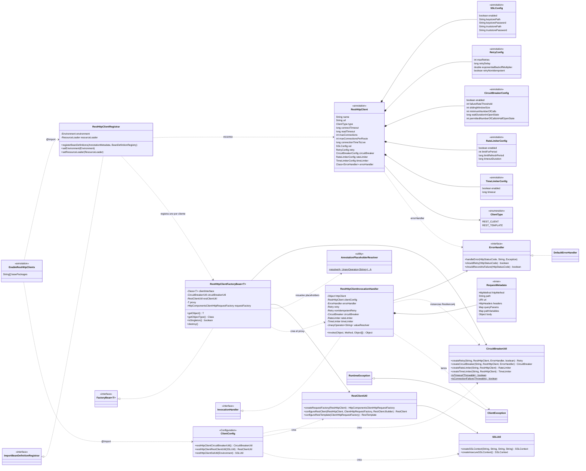

# sbj-util-client

Librería para declarar **clientes REST como interfaces** en Spring Boot, con patrones de resiliencia de
Resilience4j (retry, circuit breaker, rate limiter y time limiter) integrados.

Los métodos se describen con las mismas anotaciones de Spring Web que se usan en los controladores
(`@GetMapping`, `@PathVariable`, `@RequestParam`, etc.); la librería genera un proxy que hace la petición
con `RestClient` o `RestTemplate` sobre Apache HttpClient 5.

## Requisitos

- Java 21
- Spring Boot 4.1
- Maven 3.9+

## Instalación

Instala la librería en tu repositorio local:

```bash
mvn clean install
```

Y agrégala como dependencia:

```xml
<dependency>
    <groupId>com.juniverse.client</groupId>
    <artifactId>sbj-util-client</artifactId>
    <version>1.0.0</version>
</dependency>
```

## Uso rápido

1. Activa los clientes en una clase de configuración. Si no indicas `basePackages`, se busca en el paquete
   de esa clase.

```java
@Configuration
@EnableRestHttpClients(basePackages = "com.miempresa.clientes")
public class ClientesConfig {
}
```

2. Declara el cliente:

```java
@RestHttpClient(name = "userClient", url = "https://api.ejemplo.com")
public interface UserClient {

    @GetMapping(value = "/users/{id}", headers = "X-App=demo")
    User getUser(@PathVariable("id") long id);

    @GetMapping("/users")
    List<User> search(@RequestParam(name = "page", defaultValue = "1") int page,
                      @RequestParam(name = "tag", required = false) List<String> tags);

    @PostMapping(path = "/users", consumes = MediaType.APPLICATION_JSON_VALUE)
    User create(@RequestBody User user, @RequestHeader("X-Trace") String traceId);
}
```

3. Inyéctalo como cualquier bean:

```java
@Service
public class UserService {

    private final UserClient userClient;

    public UserService(UserClient userClient) {
        this.userClient = userClient;
    }
}
```

El nombre del bean es `name()` o, si está vacío, el nombre de la interfaz con la primera letra en
minúscula (`userClient`).

## Anotaciones de los métodos

Se admiten `@GetMapping`, `@PostMapping`, `@PutMapping`, `@PatchMapping`, `@DeleteMapping` y
`@RequestMapping(method = ...)`.

| Atributo | Cómo se usa |
|---|---|
| `value` / `path` | Ruta relativa a `url()` (se une con una sola `/`). Solo se admite una ruta. |
| `method` | Método HTTP. Solo se admite uno. |
| `headers` | Headers fijos con el formato de Spring `"Nombre=valor"`. Las condiciones sin valor (`"Nombre"`, `"!Nombre"`, `"Nombre!=valor"`) se ignoran con un warning. |
| `params` | Query params fijos con el formato `"nombre=valor"` (las condiciones sin valor se ignoran con un warning). |
| `produces` | Se envía como header `Accept`. |
| `consumes` | El primer valor se envía como header `Content-Type`. |

Un `@RequestMapping` en la **interfaz** aporta un prefijo de ruta y valores por defecto de `headers`,
`params`, `produces`, `consumes` y `method`; los del método los complementan o reemplazan:

```java
@RestHttpClient(url = "${api.url}")
@RequestMapping(path = "/v1", headers = "X-Client=inventario", params = "tenant=acme")
public interface InventarioClient {

    @GetMapping("/stock")          // GET {api.url}/v1/stock?tenant=acme con X-Client: inventario
    Stock stock();
}
```

Un método sin anotación de mapping, sin método HTTP o con más de una ruta o método lanza `ClientException`
al invocarlo. Los métodos `default` de la interfaz se ejecutan normalmente, sin petición HTTP, y
`equals`/`hashCode`/`toString` usan la identidad del proxy.

### Tipos de retorno

| Tipo de retorno | Resultado |
|---|---|
| `T` (incluidos genéricos como `List<User>`) | El cuerpo convertido a `T`, sin perder los genéricos. |
| `ResponseEntity<T>` | La respuesta completa (estado, headers y cuerpo). |
| `void` / `ResponseEntity<Void>` | No se lee el cuerpo. |

Si el método devuelve un primitivo (`int`, `boolean`, ...) y la respuesta no tiene cuerpo, se lanza
`ClientException`.

## Anotaciones de los parámetros

| Anotación | Se envía como |
|---|---|
| `@PathVariable` | Variable de la ruta (`{id}`). |
| `@RequestParam` | Query param. |
| `@RequestHeader` | Header; reemplaza al del mismo nombre declarado en `headers` del mapping. |
| `@RequestBody` | Cuerpo de la petición. |

- **Nombre:** se usa `name`/`value`; si no se indica, el nombre del parámetro en Java (requiere compilar
  con `-parameters`, que ya activa `spring-boot-starter-parent`).
- **Valores `null` o vacíos:** se usa `defaultValue` si existe; si `required = false` se omite; si es
  requerido se lanza `ClientException`. Una `@PathVariable` sin valor siempre lanza error, y un
  `@RequestBody` `null` solo se permite con `required = false`.
- **Codificación:** cada valor se codifica una sola vez en la URL (`a&b` → `a%26b`, `a b/c` → `a%20b%2Fc`).

### Listas y arreglos

`List`, `Set`, cualquier `Iterable` y los arreglos (incluidos los primitivos como `int[]`) se expanden.
Los elementos `null` se saltan y una lista vacía cuenta como valor faltante.

| Anotación | Ejemplo | Resultado |
|---|---|---|
| `@RequestParam` | `List.of("a", "b")` | `?tag=a&tag=b` |
| `@RequestHeader` | `new String[]{"admin", "user"}` | header con dos valores |
| `@PathVariable` | `List.of(1, 2, 3)` | `/items/1%2C2%2C3` (unidos con coma) |

### Map

Un parámetro declarado como `Map` o `MultiValueMap` aporta una entrada por clave (el nombre de la
anotación se ignora):

```java
@GetMapping("/items")
String search(@RequestParam Map<String, Object> filtros);
// {q: "a&b", tag: [x, y], page: 2}  →  /items?q=a%26b&tag=x&tag=y&page=2

@GetMapping("/orgs/{org}/items/{id}")
String byPath(@PathVariable Map<String, Object> variables);
```

Las entradas con clave `null`, valor `null` o lista vacía se saltan. Solo un mapa `null` cuenta como
faltante; un mapa vacío no envía nada.

## Configuración del cliente

Todo se configura en `@RestHttpClient`:

| Atributo | Por defecto | Descripción |
|---|---|---|
| `url` | `""` | URL base del servicio. |
| `type` | `REST_CLIENT` | `REST_CLIENT` o `REST_TEMPLATE`. |
| `connectTimeout` | `5000` | Tiempo máximo para abrir la conexión TCP y para obtener una conexión libre del pool (ms). |
| `readTimeout` | `30000` | Tiempo máximo de espera de la respuesta una vez conectado (ms). |
| `maxConnections` | `100` | Conexiones totales del pool. |
| `maxConnectionsPerRoute` | `20` | Conexiones por ruta. |
| `connectionTimeToLive` | `-1` | Tiempo de vida de las conexiones (ms); `-1` sin límite. |
| `ssl` | `@SSLConfig` | Keystore y truststore. |
| `retry`, `circuitBreaker`, `rateLimiter`, `timeLimiter` | | Resiliencia (ver abajo). |
| `errorHandler` | `DefaultErrorHandler` | Manejo de respuestas con error. |

## Placeholders de propiedades

Los atributos de texto admiten placeholders `${...}` que se resuelven con el `Environment` de Spring
(`application.properties`/`.yml`, variables de entorno, propiedades del sistema), con valor por defecto
opcional `${clave:valor}`:

```java
@RestHttpClient(name = "${clientes.pagos.nombre:pagosClient}", url = "${clientes.pagos.url}",
        ssl = @SSLConfig(keystorePath = "${clientes.pagos.keystore}", keystorePassword = "${KEYSTORE_PASSWORD}"))
public interface PagosClient {

    @GetMapping(path = "${clientes.pagos.version:/v1}/pagos", headers = "X-Api-Key=${clientes.pagos.api-key}")
    List<Pago> list(@RequestParam(name = "size", defaultValue = "${clientes.pagos.page-size:20}") int size);
}
```

- Se resuelven: todos los atributos de texto de `@RestHttpClient` y de sus anotaciones anidadas (`name`,
  `url`, rutas y contraseñas de `@SSLConfig`), `basePackages` de `@EnableRestHttpClients`, y en los métodos
  `path`, `headers`, `produces`, `consumes` y el `defaultValue` de `@RequestParam`/`@RequestHeader`.
- Un placeholder sin valor ni valor por defecto hace fallar el arranque (como `@Value`).
- Los atributos numéricos o booleanos (timeouts, `maxRetries`, `enabled`, etc.) no admiten placeholders
  porque Java exige constantes de ese tipo en las anotaciones.

## Resiliencia

Los decoradores se aplican en el orden que recomienda Resilience4j:
**Retry (el más externo) → CircuitBreaker → RateLimiter → TimeLimiter → petición**. Así cada intento pasa
por el circuit breaker, consume un permiso del rate limiter y tiene su propio límite de tiempo.

```java
@RestHttpClient(
        url = "https://api.ejemplo.com",
        retry = @RetryConfig(maxRetries = 3, retryDelay = 500, exponentialBackoffMultiplier = 2.0,
                             retryNonIdempotent = false),
        circuitBreaker = @CircuitBreakerConfig(enabled = true, failureRateThreshold = 50),
        rateLimiter = @RateLimiterConfig(enabled = true, limitForPeriod = 100, limitRefreshPeriod = 1000),
        timeLimiter = @TimeLimiterConfig(enabled = true, timeout = 2000))
public interface PagosClient { ... }
```

- **Retry:** siempre activo. `maxRetries` es el número total de intentos (incluido el primero). Los errores
  HTTP se reintentan solo si `ErrorHandler.shouldRetry` lo permite; los timeouts y los errores de red
  siempre. No se reintenta si el circuito está abierto (`CallNotPermittedException`), si el rate limiter
  rechaza la llamada (`RequestNotPermitted`) ni ante otros `ClientException` (errores de configuración o de
  uso).
- **`POST` y `PATCH` (no idempotentes):** para no duplicar operaciones, solo se reintentan cuando falla la
  conexión (conexión rechazada, timeout de conexión o pool sin conexiones libres), porque ahí la petición
  nunca llegó al servidor. Tras un error HTTP (incluso 502/503/504), un timeout o un corte de conexión no se
  reintentan. Si el servicio sí las trata de forma idempotente (por ejemplo, con una clave de idempotencia),
  `@RetryConfig(retryNonIdempotent = true)` las reintenta igual que a `GET`, `PUT` o `DELETE`.
- **Circuit breaker:** cuenta como falla lo que indique `ErrorHandler.shouldRecordAsFailure` (por defecto
  los 5xx), los timeouts y los errores de red; los 4xx no abren el circuito.
- **Circuit breaker, rate limiter y time limiter:** desactivados por defecto (`enabled = false`).
- **Timeout:** si un intento excede el time limiter, la petición se interrumpe y se lanza `ClientException`
  con un `TimeoutException` como causa (y se reintenta según `retry`). Las peticiones con time limiter
  corren en hilos virtuales, no en el `ForkJoinPool` común.

## Manejo de errores

Los errores HTTP llegan a quien llama como `HttpClientErrorException` / `HttpServerErrorException` (no se
envuelven). `ClientException` se reserva para errores de la librería: configuración, registro, valores
requeridos faltantes y timeout.

`DefaultErrorHandler`:

- 4xx → `HttpClientErrorException` y 5xx → `HttpServerErrorException` (la subclase específica, por ejemplo
  `NotFound` o `ServiceUnavailable`), con el cuerpo en el mensaje y conservando headers y cuerpo de la
  respuesta.
- Reintenta 502, 503 y 504.
- Cuenta los 5xx como falla del circuit breaker.

Para cambiarlo, implementa `ErrorHandler` y declárala en `errorHandler`. Si existe un bean de ese tipo se
usa ese; si no, Spring crea la instancia con inyección de dependencias (puede recibir beans por
constructor):

```java
public class MiErrorHandler implements ErrorHandler {
    @Override
    public void handleError(HttpStatusCode status, String body, Exception e) { ... }

    @Override
    public boolean shouldRetry(HttpStatusCode status) { return status.value() == 429; }

    @Override
    public boolean shouldRecordAsFailure(HttpStatusCode status) { return status.is5xxServerError(); }
}
```

## SSL

```java
@RestHttpClient(url = "https://api.interna.com",
        ssl = @SSLConfig(keystorePath = "classpath:cliente.p12", keystorePassword = "...",
                         truststorePath = "/etc/certs/truststore.jks", truststorePassword = "..."))
```

- Las rutas admiten `classpath:` o una ruta del sistema de archivos.
- `.p12` / `.pfx` se leen como PKCS12; cualquier otra extensión como JKS.
- Sin keystore ni truststore se usa el contexto SSL por defecto de la JVM.
- `@SSLConfig(enabled = false)` desactiva la validación de certificados **solo** si alguno de los perfiles
  activos de Spring (incluidos los de `application.properties`, por ejemplo `spring.profiles.active=dev,kafka`)
  es `dev`, `local` o `development`; en cualquier otro caso falla al arrancar.

## Integración con Spring Boot

En una aplicación Spring Boot los clientes usan la misma configuración HTTP que el resto de la aplicación:

- **`REST_CLIENT`:** se aplican los `RestClientCustomizer` de la aplicación, entre ellos el que registra los
  message converters con el **Jackson configurado** (por ejemplo `spring.jackson.property-naming-strategy`),
  además de los interceptores u observabilidad que agreguen otros customizers.
- **`REST_TEMPLATE`:** se construye con el `RestTemplateBuilder` de la aplicación (message converters,
  interceptores, `RestTemplateCustomizer`).
- Los timeouts, el pool y el SSL siempre son los de `@RestHttpClient`: la configuración HTTP global de
  Spring Boot no los reemplaza.
- Sin Spring Boot (Spring "plano") se usan los valores por defecto de `RestClient`/`RestTemplate`.

La librería no agrega servidor web (Tomcat, Spring MVC) ni Spring Cloud a la aplicación: solo depende de
`spring-boot-starter-restclient`, Apache HttpClient 5 y los módulos de Resilience4j (circuitbreaker, retry,
ratelimiter, timelimiter).

Los beans internos se llaman `restHttpClientCircuitBreakerUtil`, `restHttpClientRestClientUtil` y
`restHttpClientSslUtil`, así que no chocan con beans de la aplicación, ni siquiera si esta define los suyos
del mismo tipo.

## Ciclo de vida

- Cada cliente tiene su propio pool de conexiones, que se cierra al cerrar el contexto de Spring.
- El tipo del bean se conoce sin instanciarlo, así que la inyección por tipo funciona sin inicializar los
  clientes antes de tiempo.
- Si dos `@EnableRestHttpClients` escanean el mismo paquete, cada cliente se registra una sola vez. Si dos
  clientes distintos acaban con el mismo nombre de bean, el arranque falla pidiendo un `name` único.

## Arquitectura

### Diagrama de clases



### Cómo encajan las piezas

**Al arrancar el contexto**

1. `@EnableRestHttpClients` importa `RestHttpClientRegistrar` y `ClientConfig`.
2. `RestHttpClientRegistrar` escanea `basePackages` y registra un `RestHttpClientFactoryBean` por cada
   interfaz `@RestHttpClient`.
3. `ClientConfig` define los beans compartidos `CircuitBreakerUtil`, `RestClientUtil` y `SSLUtil`, que
   los factory beans reciben por nombre (con prefijo `restHttpClient`, para no chocar con beans de la
   aplicación).
4. Cada `RestHttpClientFactoryBean` crea su proxy una sola vez:
   - resuelve los placeholders con `AnnotationPlaceholderResolver`;
   - crea el pool HTTP con `RestClientUtil`, que usa `SSLUtil`, y sobre él el `RestClient` (con los
     `RestClientCustomizer` de la aplicación) o el `RestTemplate` (con su `RestTemplateBuilder`);
   - obtiene el `ErrorHandler`;
   - crea el proxy, respaldado por un `RestHttpClientInvocationHandler`.

**En cada llamada a un método del cliente**

1. `RestHttpClientInvocationHandler` lee las anotaciones de Spring Web de la interfaz, del método y de los
   parámetros, y arma un `RequestMetadata` con el método HTTP, la URI codificada, los headers y el cuerpo.
2. Ejecuta la petición con `RestClient` o `RestTemplate`, envuelta con Retry → CircuitBreaker →
   RateLimiter → TimeLimiter. Las instancias de Resilience4j las crea `CircuitBreakerUtil`.
3. Si la respuesta es un error HTTP, `ErrorHandler.handleError` decide qué excepción se lanza. Las
   respuestas correctas se convierten al tipo de retorno del método.

**Al cerrar el contexto**

- `RestHttpClientFactoryBean.destroy()` cierra el pool de conexiones de cada cliente.

## Desarrollo

```bash
mvn clean verify                   # compila, ejecuta tests, cobertura (JaCoCo) y checkstyle
mvn test -Dtest=ClaseTest#metodo   # un solo test
mvn checkstyle:check               # solo checkstyle
```

- La fase `test` falla si la cobertura de complejidad (JaCoCo) es menor a 80 %.
- Checkstyle (`config/checkstyle.xml`) falla con advertencias: líneas de máximo 120 caracteres,
  Javadoc obligatorio, sin tabuladores ni imports con `*`.

### Convención de idioma

- **Español:** comentarios, Javadoc y este README.
- **Inglés:** nombres de clases, métodos y variables, mensajes de log y mensajes de excepciones.
